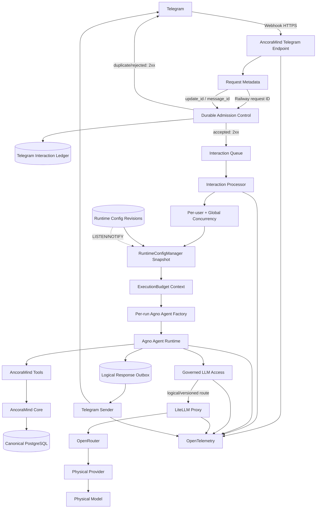

# Propuesta técnica inicial — LLM Access Governance

**Fecha del assessment:** 13 de septiembre de 2026  
**Repositorio revisado:** `c:\Users\0020572\Documents\Formación\TheBridge\ancoramind-core`  
**Commit:** `9fe67ec fix(runtime): stop malformed tool-call stream loops`  
**Versión instalada de Agno:** `2.9.0`

No he modificado código, infraestructura, Railway ni PostgreSQL. El árbol Git está limpio. Como comprobación no mutativa, los 26 tests relacionados con Agent, configuración y webhook continúan pasando.

---

## Conclusión ejecutiva

La recomendación es una arquitectura **híbrida B+C**:

1. **AncoraMind conserva el control determinista** de:
   - idempotencia Telegram;
   - admission/rate limiting;
   - concurrencia;
   - presupuesto total de la ejecución;
   - selección de ruta lógica;
   - correlation IDs;
   - auditoría de configuración.

2. La configuración operativa de AncoraMind se guarda como **revisiones inmutables en PostgreSQL**, con un `RuntimeConfigManager` en memoria. La ruta crítica toma una instantánea en memoria y no consulta PostgreSQL ni disco.

3. **LiteLLM Proxy es el candidato recomendado para el target state**, ejecutado como servicio privado separado en Railway, encargado de:
   - traducir rutas lógicas a provider/model;
   - rate limits y presupuestos LLM;
   - coste;
   - retries/fallbacks limitados;
   - cooldown/circuit protection;
   - observabilidad de inferencia.

4. La adopción de LiteLLM debe hacerse **después** de introducir idempotencia, correlación y execution budget. No solucionará por sí solo la duplicación de updates ni los loops del Agent.

5. Durante la transición, OpenRouter puede seguir actuando como gateway externo detrás de una abstracción propia `LLMAccess`. No recomiendo desplegar LiteLLM como primera medida del plan.

6. El mecanismo actual de `tool_call_limit=8` debe conservarse únicamente como **último techo de seguridad**, no como presupuesto principal.

7. Hay dos gaps actuales que deberían considerarse prioritarios aunque sean adyacentes al requisito:
   - la supuesta allowlist Telegram no está realmente aplicada;
   - los grupos no se rechazan como exige la arquitectura.

---

# 1. Current-state assessment

## 1.1 Flujo actual

```text
Telegram
  -> POST /telegram/webhook de Agno AgentOS
  -> BackgroundTask de FastAPI
  -> Agent singleton de Agno
  -> SafeOpenRouter
  -> OpenRouter
  -> provider/model físico
```

La aplicación no implementa el webhook Telegram directamente. Lo genera `AgentOS` mediante la interfaz `Telegram`.

El wiring principal está en:

- `c:\Users\0020572\Documents\Formación\TheBridge\ancoramind-core\src\main.py:161-227`
- `c:\Users\0020572\Documents\Formación\TheBridge\ancoramind-core\src\agent\ancora_agent.py:114-237`

## 1.2 Instanciación de provider y model

Al arrancar el proceso:

1. Se crea `Settings()`.
2. Se leen `LLM_PROVIDER`, `LLM_MODEL`, `LLM_BASE_URL` y las API keys.
3. `create_model_from_settings()` crea un objeto físico de Agno:
   - `OpenAIChat`;
   - `SafeOpenRouter`;
   - `OpenAILike`.
4. Ese objeto se asigna al `Agent` singleton.
5. El `Agent` se entrega a la interfaz Telegram.

Por tanto:

- provider y model son configuración de **startup**;
- el Agent depende directamente de un modelo físico;
- cambiar variables Railway reconstruye/reinicia el servicio;
- no existe revisión de configuración;
- no existe snapshot explícito por ejecución;
- no existe alias lógico propio.

## 1.3 Segunda vía de inferencia

Existe una segunda ejecución LLM dentro de la tool documental:

- `c:\Users\0020572\Documents\Formación\TheBridge\ancoramind-core\src\agent\tools\documents.py:29-44`
- `c:\Users\0020572\Documents\Formación\TheBridge\ancoramind-core\src\domain\documents\service.py:118-146`

Cuando se llama `analyze_document`:

1. La tool crea un modelo nuevo desde `Settings()`.
2. `DocumentService` crea un segundo `Agent`.
3. Este Agent llama a `arun()` para la extracción.

Actualmente este Agent anidado:

- no comparte un execution budget explícito con el Agent principal;
- no comparte correlación propia de AncoraMind;
- no tiene límite temporal explícito;
- no tiene configuración de retry/fallback explícita;
- silencia cualquier excepción con `except Exception: pass`;
- usa el valor por defecto `provider="openai"` para la auditoría, aunque el modelo real pueda ser OpenRouter.

Esto implica que `ai_extractions.provider` puede ser incorrecto y que futuras llamadas anidadas podrían escapar al presupuesto del run exterior.

## 1.4 Protecciones existentes

Los tres commits más recientes introdujeron:

| Commit | Protección |
|---|---|
| `bcb35cd` | `tool_call_limit`, default 8 |
| `7cfa8a5` | ignorar mensajes cuyo `from.is_bot` sea `true` |
| `9fe67ec` | convertir tool calls malformadas/vacías en `None` para cortar el loop |

El Agent actual:

- tiene `tool_call_limit=8`;
- incluye hasta 10 runs de historial;
- expone actualmente 32 tools al modelo;
- no configura retries de Agent;
- no configura retries de Model;
- no configura fallbacks;
- no configura timeout total;
- no configura hooks de presupuesto;
- no configura límites de concurrencia.

Agno 2.9.0 sí dispone de:

- retries por llamada de modelo;
- retries del run completo;
- `FallbackConfig`;
- `pre_hooks`, `post_hooks` y `tool_hooks`;
- `StopAgentRun`;
- métricas de runs, modelos y tools;
- eventos `ModelRequestStarted` y `ModelRequestCompleted`.

Retry de modelo y retry del Agent son mecanismos distintos. Agno también distingue fallback y no aplica fallback general a errores cliente no recuperables. ([docs.agno.com](https://docs.agno.com/models/fallback-models?utm_source=openai))

## 1.5 Telemetría actual

El repositorio solo configura logging textual con `logging.basicConfig()`.

No existen:

- logs JSON estructurados;
- `correlation_id`;
- propagación W3C `traceparent`;
- OpenTelemetry configurado;
- métricas de coste;
- alertas de anomalía;
- tracking propio de retries/fallbacks;
- IDs de gateway/provider;
- relación entre request HTTP y run de Agno.

Aunque el repositorio no configura tracing, los defaults de Agno tienen:

- `Agent.telemetry=True`;
- `AgentOS.telemetry=True`;
- `AgentOS.tracing=False`.

Durante la inspección se observó una llamada de startup a `os-api.agno.com`. El código instalado indica que la telemetría de Agno incluye IDs de run/session y metadatos de modelo, DB y capacidades, no prompts. Aun así, para un asistente personal debería existir una decisión explícita sobre mantenerla o desactivarla.

Agno ofrece tracing basado en OpenTelemetry, capaz de representar runs, llamadas a modelos y tools, pero no está activado actualmente. ([docs.agno.com](https://docs.agno.com/tracing/overview?utm_source=openai))

## 1.6 Allowlist y private chats

La variable `ALLOWED_TELEGRAM_USER_IDS` se parsea correctamente, pero después solo se utiliza así:

```python
reply_to_mentions_only=bool(allowlist)
```

Eso controla el comportamiento ante menciones en grupos; no comprueba que `from.id` pertenezca a la lista.

Además, el router de Agno:

- considera `group` y `supergroup` como grupos;
- los procesa si se menciona al bot;
- no rechaza todos los chats no privados;
- no conoce la lista de usuarios autorizados.

Por tanto, el estado real no cumple lo documentado en `docs/architecture.md`:

- **la allowlist no está aplicada**;
- **private-chats-only no está aplicado**.

Esto debería corregirse en el mismo nuevo admission layer, antes de cualquier ejecución IA.

---

# 2. Identidad e idempotencia Telegram actuales

## 2.1 Dónde se recibe `update_id`

En el router instalado de Agno:

`c:\Users\0020572\Documents\Formación\TheBridge\ancoramind-core\.venv\Lib\site-packages\agno\os\interfaces\telegram\router.py:129-140`

```python
body = await request.json()
update_id = body.get("update_id")
```

## 2.2 Dónde se recibe `message.message_id`

En el BackgroundTask:

`c:\Users\0020572\Documents\Formación\TheBridge\ancoramind-core\.venv\Lib\site-packages\agno\os\interfaces\telegram\router.py:295-312`

```python
incoming_message_id = message.get("message_id")
```

## 2.3 Registro actual

### `update_id`

Se introduce en un diccionario en memoria:

`c:\Users\0020572\Documents\Formación\TheBridge\ancoramind-core\.venv\Lib\site-packages\agno\os\interfaces\telegram\state.py:95-139`

Características:

- vive únicamente en el proceso;
- TTL de 60 segundos;
- no se guarda en PostgreSQL;
- no se incluye en el run de Agno;
- no se registra en logs;
- se pierde en deploy/restart;
- no se comparte entre réplicas o workers.

### `message_id`

Solo se utiliza como `reply_to_message_id` en grupos o con respuestas citadas. No se persiste ni se incluye en metadata.

## 2.4 HTTP status actual

El endpoint devuelve:

| Escenario | Respuesta |
|---|---|
| Update nuevo válido | `200 {"status":"processing"}` |
| Update duplicado en memoria durante 60 s | `200 {"status":"duplicate"}` |
| Sin `message`/`edited_message` | `200 {"status":"ignored"}` |
| Secret inválido | `403` |
| Error al parsear/procesar el webhook antes del enqueue | `500` |

El `200 processing` se devuelve inmediatamente después de registrar un `BackgroundTask`. La inferencia no se espera antes de devolver el HTTP response.

Telegram reenvía los webhooks cuando la respuesta no es `2xx`, y documenta expresamente `update_id` como identificador para ignorar updates repetidos. ([core.telegram.org](https://core.telegram.org/bots/api?utm_source=openai))

## 2.5 ¿Una inferencia lenta impide el 2xx?

**No en el flujo actual.**

La inferencia se ejecuta en `_process_message` como BackgroundTask después de preparar la respuesta HTTP.

Por tanto, una inferencia lenta no debería causar directamente un retry de Telegram. Sin embargo:

- si el proceso cae después del `200` y antes de completar el task, el update se pierde;
- si hay un deploy mientras se ejecuta, el task puede quedar incompleto;
- Telegram ya considera aceptado el update y no lo reenviará.

## 2.6 ¿Puede el mismo `update_id` ejecutar más de una vez el Agent?

**Sí.**

Puede ocurrir en:

1. Reentrega pasados los 60 segundos.
2. Restart o nuevo deployment.
3. Varias réplicas Railway.
4. Varios procesos Uvicorn.
5. Reenvío manual del payload.
6. Pérdida del estado en memoria.
7. Primera ejecución todavía activa y nuevo intento después del TTL.

En un solo proceso, dentro del TTL, la protección actual probablemente evita dos ejecuciones concurrentes del mismo ID. No proporciona una garantía distribuida ni durable.

## 2.7 Gap semántico importante

El flujo actual es:

```text
marcar update_id en RAM
-> devolver 200
-> ejecutar Agent después
```

Esto no es ni procesamiento durable ni exactamente-once:

- puede haber **cero ejecuciones** después del 200;
- puede haber **más de una ejecución** después de restart/TTL;
- no existe ledger de respuesta lógica;
- no existe outbox de Telegram;
- no existe idempotency key para las acciones generadas.

---

# 3. Posible causa del incidente de las 78 llamadas

## Hipótesis principal: loop por tool call malformada

Es la explicación con mayor respaldo en el código y commits.

`SafeOpenRouter` contiene este comentario explícito:

> Agno 2.9.0 comprobaba `tool_calls is not None` en streaming. Una lista vacía hacía continuar indefinidamente el loop sin ejecutar una tool ni incrementar el contador.

El test:

`c:\Users\0020572\Documents\Formación\TheBridge\ancoramind-core\tests\unit\test_ancora_agent.py:195-217`

reproduce exactamente un `"Hola"` con una tool call incompleta y comprueba que, con el fix, solo se realiza una petición al modelo.

Antes del fix, un patrón plausible era:

```text
Hola
 -> modelo devuelve contenido + tool call malformada
 -> Agno elimina/no puede ejecutar la tool
 -> tool_call_count no aumenta
 -> Agno considera que aún hay tool calls
 -> nueva inferencia con el historial ampliado
 -> repetición
```

El límite de ocho tools no habría detenido este caso porque el contador de Agno aumenta con function calls preparadas/ejecutadas, no con iteraciones vacías o malformadas.

## Factores amplificadores

Cada iteración reenviaba potencialmente:

- las instrucciones;
- el historial de hasta diez runs;
- los schemas de 32 tools;
- los mensajes producidos durante el loop.

Aunque no haya 78 tools reales, sí puede haber 78 turnos de modelo y un consumo de tokens creciente.

## Hipótesis secundarias

### Reentrega del webhook

Posible, pero menos respaldada:

- no se registraban `update_id` ni Railway request IDs;
- la deduplicación era solo RAM/60 s;
- no podemos demostrar cuántas entregas HTTP hubo.

### Retry/fallback configurado

Poco probable desde AncoraMind:

- `Agent.retries=0`;
- `Model.retries=0`;
- no hay `fallback_models`;
- no hay `FallbackConfig`.

OpenRouter puede efectuar routing/fallback interno entre proveedores; habría que distinguir si las 78 entradas observadas eran peticiones cliente a OpenRouter o intentos upstream internos. OpenRouter soporta routing y fallback automático entre proveedores/modelos, y devuelve métricas de uso y coste por respuesta. ([openrouter.ai](https://openrouter.ai/docs/guides/routing/provider-selection?utm_source=openai))

### Loop de bots

El commit posterior desactivó `reply_to_bot_messages`, pero Telegram indica que los bots normalmente no reciben mensajes de otros bots precisamente para evitar loops. Por eso no considero esta la causa principal sin evidencia adicional. ([core.telegram.org](https://core.telegram.org/bots/faq?utm_source=openai))

### Agent documental anidado

No explica un saludo textual. Solo se activa al ejecutar `analyze_document`.

## Evidencia que falta para determinarlo

Se necesitan:

1. El payload Telegram original y su `update_id`.
2. Railway HTTP logs del intervalo:
   - request ID;
   - path;
   - status;
   - duración.
3. Logs de aplicación del deployment exacto.
4. Commit/image desplegado durante el incidente.
5. Fila del run y sesión Agno:
   - `run_id`;
   - messages;
   - tool calls;
   - metrics;
   - status.
6. Export de actividad de OpenRouter:
   - timestamps;
   - IDs de request/generation;
   - provider/model;
   - errores;
   - tokens y coste.
7. Confirmación de qué significa “78 peticiones” en ese panel:
   - 78 llamadas HTTP de AncoraMind;
   - 78 generaciones;
   - o 78 intentos de providers internos.
8. Variables efectivas del deployment:
   - model;
   - streaming;
   - límites;
   - routing/fallback de OpenRouter.

**Conclusión provisional:** el loop de tool calls malformadas es altamente plausible y está reproducido por el test añadido, pero no puede afirmarse que explique exactamente las 78 llamadas sin los logs de producción.

---

# 4. Gap analysis

| Área | Estado actual | Gap |
|---|---|---|
| Idempotencia Telegram | RAM, TTL 60 s | No durable, distribuida ni auditable |
| `update_id` | Recibido | No persistido ni correlacionado |
| `message_id` | Recibido | Solo usado para replies |
| Railway request ID | No leído | No correlación con Telegram |
| Admission control | No existe | Todo update válido llega al Agent |
| Private chat | No garantizado | Grupos pueden procesarse |
| Allowlist | No aplicada | Variable conectada a un parámetro no equivalente |
| Rate limiting entrada | No existe | Sin límite por user/chat/global |
| Concurrency limiting | No existe | Runs concurrentes sobre una misma sesión |
| Execution budget | Solo 8 tools | Sin tiempo, model calls, coste, retries o loop fingerprint |
| LLM abstraction | Factory de modelos físicos | Agent depende del provider/model |
| Runtime model config | Environment de startup | Requiere deploy |
| Config snapshot | No existe | No versión/revisión por run |
| Retries | Defaults 0 | No política explícita |
| Fallback | No existe | No política explícita |
| Circuit breaker | No existe | Upstream fallido se sigue llamando |
| Gateway | OpenRouter directo | Sin gateway controlado por AncoraMind |
| Cost governance | Límite OpenRouter | Sin presupuesto por run/ruta/periodo en app |
| Tokens/coste | Agno puede recoger métricas | AncoraMind no las exporta ni audita |
| Telemetry E2E | Logging textual | Sin correlación ni trazas |
| Privacidad telemetry | No política explícita | Debug podría registrar contenido |
| Agent anidado documental | Inferencia separada | Escapa a budget/correlación |
| Config secrets | Environment | Correcto; debe mantenerse |

---

# 5. Comparativa de Gateway

## 5.1 OpenRouter directo

### Ventajas

- Ya está desplegado y operativo.
- API unificada para múltiples modelos/providers.
- Routing entre providers.
- Fallbacks de provider/model.
- Usage accounting con tokens y coste real.
- Presupuestos y guardrails externos.
- Sin nuevo servicio ni hop interno. ([openrouter.ai](https://openrouter.ai/docs/guides/routing/provider-selection?utm_source=openai))

### Limitaciones

- No resuelve idempotencia ni execution budget.
- AncoraMind sigue enviando IDs físicos de modelos.
- Configuración runtime debe resolverse en AncoraMind.
- No crea por sí solo una frontera de auditoría propiedad de AncoraMind.
- El routing interno puede hacer difícil contabilizar intentos físicos.
- Controla OpenRouter, no llamadas a futuros providers directos.

### Encaje

**Muy bueno como solución transitoria** y como última capa de routing/proveedor detrás de un `LLMAccess` propio.

---

## 5.2 LiteLLM SDK in-process

### Ventajas

- Sin hop de red adicional.
- API uniforme.
- Routing, retries, fallbacks y cooldowns en proceso.
- Cost callbacks.
- Menor operación que un servicio separado.
- Puede integrarse como infraestructura reemplazable.

### Limitaciones

- Comparte ciclo de vida y fallo con AncoraMind.
- La configuración y sincronización multi-réplica siguen siendo responsabilidad propia.
- No crea una frontera de red real.
- Rate limit y budgets globales/distribuidos requieren estado compartido.
- Acopla el proceso de AncoraMind a una dependencia grande.
- Una actualización de LiteLLM obliga a redeploy de AncoraMind.

LiteLLM diferencia el SDK para integración directa y el Proxy para gateway centralizado. ([docs.litellm.ai](https://docs.litellm.ai/))

### Encaje

Bueno si se descarta un servicio separado, pero no es el mejor target para la capability transversal solicitada.

---

## 5.3 LiteLLM Proxy separado en Railway

### Ventajas

- Frontera explícita:
  `Agent -> logical route -> gateway -> provider`.
- OpenAI-compatible: encaja con `OpenAILike`.
- Aliases mediante `model_name`.
- Virtual keys.
- RPM, TPM y máximo de requests paralelas.
- Spend tracking y presupuestos.
- Routing, retries, fallbacks y cooldown por deployment.
- Métricas de proxy, providers, fallbacks, cooldown y latencia.
- Integraciones OpenTelemetry/Prometheus.
- Administración de modelos en DB/Admin UI. ([docs.litellm.ai](https://docs.litellm.ai/))

### Limitaciones

- Nuevo servicio operativo.
- Nuevo hop HTTP.
- Necesita persistencia propia.
- Los budgets de LiteLLM **no deben desplegarse sin DB**: la documentación indica que, sin ella, no se aplican como hard cap y pueden fallar abiertos. ([github.com](https://github.com/BerriAI/litellm-docs/blob/main/docs/proxy/users.md))
- Añadirlo encima de OpenRouter crea dos niveles de routing/fallback.
- Algunas capacidades avanzadas varían entre OSS y Enterprise.
- Ha tenido advisories de seguridad relevantes en 2026; debe ir privado, con versión/digest fijado, rutas mínimas y revisión de seguridad. ([github.com](https://github.com/BerriAI/litellm/security/advisories?utm_source=openai))

### Comunicación Railway

Debe estar en el mismo proyecto/environment que AncoraMind y consumirse mediante:

```text
http://litellm.railway.internal:<port>
```

Railway proporciona DNS interno, tráfico cifrado mediante WireGuard, aislamiento por environment y evita exposición pública/egress entre servicios. ([docs.railway.com](https://docs.railway.com/networking/private-networking?utm_source=openai))

### Encaje

**Mejor candidato para el target state**, condicionado a un spike de seguridad, coste operativo y latencia.

---

## 5.4 Portkey

### Ventaja clara

Portkey ofrece explícitamente:

- retries;
- fallbacks;
- circuit breaker;
- routing condicional;
- budgets;
- rate limits;
- observabilidad y OpenTelemetry. ([portkey.ai](https://portkey.ai/docs/product/ai-gateway?utm_source=openai))

### Desventajas

- Mayor dependencia de producto/SaaS.
- Varias políticas de presupuesto/rate limit son Enterprise o planes seleccionados.
- Menor alineación con una solución OSS privada y pequeña.
- Añade otro vendor que puede tratar metadata sensible. ([portkey.ai](https://portkey.ai/docs/product/ai-gateway/virtual-keys/budget-limits?utm_source=openai))

### Encaje

Alternativa válida si se prioriza operación gestionada sobre control y coste. No es mi primera recomendación.

---

## 5.5 Kong y gateways enterprise

No recomendados para el estado actual:

- más componentes;
- orientación a plataforma/Kubernetes;
- mayor carga operacional;
- capacidad muy superior a la necesaria para un único asistente.

Podrían ser referencia futura si AncoraMind evoluciona a múltiples productos/equipos.

---

# 6. Recomendación concreta

## Target state

**LiteLLM Proxy privado en Railway**, precedido por una abstracción propia `LLMAccess` y acompañado de configuración PostgreSQL cacheada.

Distribución de responsabilidades:

| Responsabilidad | Propietario |
|---|---|
| Telegram idempotency | AncoraMind |
| Private chat / allowlist | AncoraMind |
| Admission/rate de usuarios | AncoraMind |
| Concurrencia por usuario/global | AncoraMind |
| Presupuesto total del run | AncoraMind |
| Ruta lógica seleccionada | AncoraMind |
| Provider/model físico | LiteLLM |
| RPM/TPM LLM | LiteLLM |
| Coste por route/model | LiteLLM |
| Retry/fallback/cooldown upstream | LiteLLM |
| Hard economic limit | OpenRouter |
| Correlación E2E | AncoraMind + OTel |
| Secrets | Railway environment |

## Restricción fundamental

No debe haber retries/fallbacks independientes en todas las capas.

Al introducir LiteLLM:

```text
Agno Agent retries       = 0
Agno Model retries       = 0
LiteLLM retries/fallback = política única y acotada
OpenRouter routing       = explícito y conocido
OpenRouter hard budget   = última barrera
```

## Rollout recomendado

No empezar desplegando LiteLLM.

Primero:

1. durable Telegram admission;
2. correlación;
3. execution budget;
4. `LLMAccess`;
5. runtime configuration.

Después conectar:

```text
LLMAccess -> OpenRouter directo
```

Y finalmente:

```text
LLMAccess -> LiteLLM privado -> OpenRouter
```

Esto permite medir si LiteLLM aporta suficiente valor antes de convertirlo en dependencia crítica.

---

# 7. Arquitectura objetivo



---

# 8. Propuesta de configuración runtime

## 8.1 Evaluación de alternativas

### A. YAML/TOML con hot reload

**Pros:**

- sencillo;
- legible;
- versionable en Git;
- validable con Pydantic.

**Contras:**

- en Railway el filesystem del contenedor no es un control plane natural;
- un cambio persistente exige volumen, endpoint de escritura o nuevo image;
- sincronización multi-réplica compleja;
- auditoría y concurrencia de ediciones manual;
- watcher y atomic rename específicos de plataforma.

**Uso recomendado:** bootstrap local, fixtures y export/import. No como fuente de verdad de producción.

### B. PostgreSQL

**Pros:**

- revisiones y auditoría transaccional;
- activación atómica;
- accesible desde todas las réplicas;
- validación antes de activar;
- rollback explícito;
- encaja con la infraestructura actual.

**Contras:**

- requiere schema/migración futura;
- necesita un canal administrativo seguro;
- LISTEN/NOTIFY requiere conexión persistente.

**Recomendado para configuración AncoraMind.**

### C. LLM Gateway

**Pros:**

- ubicación natural de modelos, providers, fallbacks y rate policies;
- aliases lógicos;
- gestión independiente del Agent;
- coste y health por deployment.

**Contras:**

- no debe almacenar políticas de Telegram o tools;
- actualizar un alias mutable durante un run puede afectar sus siguientes model turns;
- dependencia del control plane del gateway.

**Recomendado para configuración física de inferencia.**

## 8.2 Modelo híbrido

### En PostgreSQL de AncoraMind

- ruta lógica default;
- execution budgets;
- admission limits;
- concurrency limits;
- timeout;
- política de privacidad/telemetría;
- referencia a versión inmutable del gateway;
- schema version;
- config revision.

### En LiteLLM

- alias versionado;
- provider/model físico;
- deployment;
- timeout upstream;
- retries;
- fallback;
- cooldown;
- RPM/TPM;
- budgets de modelo/key.

## 8.3 Aliases versionados

No recomiendo cambiar directamente el contenido de un alias mutable usado por runs activos:

```text
ancoramind-default -> modelo A
```

porque un run con varias llamadas podría empezar con A y continuar con B.

Propuesta:

```text
Alias lógico solicitado:       ancoramind-default
Revisión AncoraMind 42:         ancoramind-default-r42
Revisión AncoraMind 43:         ancoramind-default-r43
```

Cada run toma al inicio:

```text
logical_route: ancoramind-default
effective_gateway_route: ancoramind-default-r42
config_version: 42
```

El alias versionado no cambia. La revisión 43 solo afecta a nuevos runs.

## 8.4 `RuntimeConfigManager`

Comportamiento:

1. Al arrancar:
   - carga la revisión activa desde PostgreSQL;
   - valida con Pydantic;
   - si es inválida, usa `DEFAULT_MODEL`/ruta segura de environment;
   - registra el motivo.

2. En cada interacción:
   - obtiene una referencia inmutable desde memoria;
   - no consulta DB ni disco;
   - la asocia al `ExecutionContext`.

3. Al actualizar:
   - valida schema;
   - valida invariantes;
   - opcionalmente prueba la ruta Gateway;
   - inserta nueva revisión inmutable;
   - activa en una transacción;
   - emite `NOTIFY`;
   - los procesos cargan y hacen un swap atómico.

4. Si la nueva revisión falla:
   - no se activa;
   - continúa la last-known-good;
   - queda auditada como `rejected`.

## 8.5 LISTEN/NOTIFY

El notification payload debería contener solo:

```text
revision=43
```

El listener consulta esa revisión una sola vez, valida y sustituye la referencia en memoria.

`NOTIFY` se entrega después del commit. No es durable, por lo que debe complementarse con:

- reconexión del listener;
- comprobación de revisión al reconectar;
- reconciliación lenta, por ejemplo cada varios minutos;
- nunca polling por request.

La conexión Supabase de session pooler en puerto 5432 soporta estado de sesión como `LISTEN/NOTIFY`; transaction mode 6543 no lo soporta. El listener deberá reservar una conexión persistente propia. ([supabase.com](https://supabase.com/docs/guides/database/connecting-to-postgres?utm_source=openai))

## 8.6 Schema conceptual

```yaml
schema_version: 1
revision: 43

routing:
  default_route: ancoramind-default
  routes:
    ancoramind-default:
      effective_gateway_route: ancoramind-default-r43
      required_capabilities:
        - tool_calling
        - structured_output
    ancoramind-fast:
      effective_gateway_route: ancoramind-fast-r12
    ancoramind-vision:
      effective_gateway_route: ancoramind-vision-r8

execution_budget:
  max_runtime_seconds: "<approved>"
  max_logical_model_calls: "<approved>"
  max_tool_calls_hard_ceiling: "<approved>"
  max_same_tool_args: "<approved>"
  max_total_upstream_attempts: "<approved>"
  max_estimated_cost_usd: "<approved>"

concurrency:
  per_user: "<approved>"
  per_chat: "<approved>"
  global: "<approved>"

admission:
  user_rpm: "<approved>"
  chat_burst: "<approved>"
```

Los valores deben calibrarse con telemetría real; no recomiendo convertir otros números arbitrarios en defaults arquitectónicos.

## 8.7 Secrets

La configuración solo podrá contener referencias:

```text
credential_ref = openrouter-primary
```

La resolución real será:

```text
openrouter-primary -> Railway secret OPENROUTER_API_KEY
```

No almacenar:

- API keys;
- LiteLLM master key;
- virtual keys;
- tokens Telegram;
- credenciales OTLP;
- claves de DB.

La documentación de LiteLLM admite referencias `os.environ/...`; esa es la única modalidad compatible con este requisito. ([docs.litellm.ai](https://docs.litellm.ai/))

## 8.8 Bootstrap/fallback

Mantener en environment:

```text
DEFAULT_MODEL
DEFAULT_LLM_PROVIDER
DEFAULT_LOGICAL_ROUTE
LLM_GATEWAY_URL
LLM_GATEWAY_API_KEY
```

El fallback de environment debe usarse para:

- cold start sin configuración válida;
- recuperación administrativa;
- ejecución sin Gateway cuando esté expresamente configurado.

No recomiendo que una caída de LiteLLM provoque automáticamente un bypass directo a OpenRouter, porque el bypass evitaría rate limits, budgets y auditoría. En modo Gateway, el default debería ser **fail closed** salvo aprobación explícita de un break-glass mode.

---

# 9. Idempotencia, rate limiting y execution budget

## 9.1 Ledger de interacciones

Tabla conceptual:

```text
telegram_interactions
- id / correlation_id
- bot_identity
- telegram_update_id
- telegram_message_id
- chat_id
- user_id
- status
- config_version
- agno_run_id
- received_at
- agent_started_at
- agent_completed_at
- completed_at
- error_class

UNIQUE(bot_identity, telegram_update_id)
```

Tabla adicional para entregas:

```text
telegram_deliveries
- interaction_id
- railway_request_id
- received_at
- duplicate
- http_result
```

Así, tres deliveries con Railway IDs distintos crean:

- una interacción;
- tres delivery records;
- una ejecución Agent.

## 9.2 Flujo admission

```text
BEGIN

INSERT telegram_interaction(update_id, correlation_id, ...)
ON CONFLICT DO NOTHING

si insert:
    aplicar allowlist/private/rate admission
    status = admitted o rejected

si conflict:
    insertar delivery duplicate=true

COMMIT

devolver 200
```

Un rate-limit rejection de un update Telegram válido debería devolver `2xx`, no `429`, porque un `429` provocaría reentregas del mismo update. Se puede generar una respuesta controlada al usuario mediante outbox.

## 9.3 At-most-once frente a recuperación

Existe una limitación distribuida inevitable:

```text
marcar agent_started
-> llamar LLM externo
-> proceso cae
-> no sabemos con certeza si la llamada se ejecutó
```

No se puede tener simultáneamente:

- ejecución externa exactamente una vez;
- retry automático tras crash;
- ausencia total de pérdida;

sin cooperación idempotente del proveedor.

Para cumplir estrictamente `at most one Agent execution` propongo:

- retry automático si el fallo ocurre **antes** de `agent_started`;
- una vez `agent_started`, nunca relanzar automáticamente;
- si el proceso cae, marcar `failed_ambiguous`;
- recuperación solo mediante acción operativa explícita.

Esto puede perder una respuesta, pero no duplicará una acción.

Debe aprobarse si el requisito es:

1. **at-most-once estricto con posible pérdida**, o
2. **effectively-once con recovery**, permitiendo reejecutar bajo las mismas idempotency keys.

## 9.4 Respuesta y acciones lógicas

Las operaciones canónicas y propuestas deben recibir el `interaction_id` o una idempotency key derivada.

Ejemplo:

```text
interaction_id + action_kind + canonical_args_hash
```

La respuesta lógica se registra en un outbox con una restricción única:

```text
UNIQUE(interaction_id, response_kind)
```

Telegram `sendMessage` no ofrece una clave de idempotencia externa. Si hay timeout después de enviar pero antes de recibir confirmación, no se puede conocer con certeza si el mensaje llegó. Para un `at-most-one send` estricto, los errores ambiguos no deben reintentarse automáticamente.

## 9.5 Separación de controles

### Telegram idempotency

Responde:

> ¿Ya se admitió este `update_id`?

### Entrada rate limiting

Responde:

> ¿Puede este usuario/chat iniciar una interacción ahora?

### Concurrency limiting

Responde:

> ¿Cuántas interacciones se ejecutan simultáneamente?

Recomendación inicial:

- una ejecución concurrente por chat;
- límite configurable por usuario;
- límite global;
- orden secuencial por sesión para evitar carreras sobre el historial.

### Execution budget

Responde:

> ¿Cuánto trabajo total puede consumir este update?

### Gateway rate limiting

Responde:

> ¿Cuántas llamadas/tokens puede enviar esta key/ruta?

### Provider hard limits

Última barrera económica y de capacidad.

## 9.6 Execution budget

Crear un `ExecutionBudget` inmutable por interacción, mantenido en un `ExecutionContext`/`ContextVar`:

- deadline monotónico;
- `logical_model_call_count`;
- `upstream_attempt_count`;
- `tool_call_count`;
- fingerprints de tools;
- retry count;
- coste estimado reservado;
- coste real acumulado;
- config version;
- cancellation state.

Debe incluir:

1. **Max runtime**
   - envolver el run con timeout;
   - cancelar de forma controlada;
   - persistir resultado parcial/estado.

2. **Max logical model calls**
   - cuenta cada turno principal;
   - incluye Agent documental y futuras llamadas anidadas.

3. **Max upstream attempts**
   - incluye retries y fallbacks del Gateway.

4. **Tool hard ceiling**
   - conservar `tool_call_limit`;
   - valor independiente del detector de loop.

5. **Repetición**
   - fingerprint:
     `tool_name + canonical_json(arguments)`;
   - detectar llamada idéntica repetida;
   - opcionalmente detectar ciclos `A -> B -> A -> B`.

6. **Max retries total**
   - no solo por componente;
   - retry y fallback consumen el mismo attempt budget.

7. **Cost budget**
   - estimación antes de llamar;
   - reserva;
   - reconciliación con coste real.

8. **Concurrency**
   - por usuario/chat;
   - global.

## 9.7 Uso de mecanismos Agno

Aprovechar:

- `tool_hooks` para contar/fingerprinting;
- `StopAgentRun` para detener loops;
- eventos de model request para métricas;
- `run_id` explícito en `Agent.arun`;
- `RunContext.metadata`;
- métricas de tokens/duración;
- cancelación del run.

No existe en Agno 2.9.0 un único objeto nativo que combine deadline, model-call count, tools, retries, coste y concurrencia. Por eso hace falta una capa AncoraMind, pero no es necesario reimplementar el loop completo.

---

# 10. Retries, fallback y circuit breaker

## 10.1 Definiciones

- **Retry:** repetir contra el mismo destino o deployment.
- **Fallback:** cambiar de deployment/provider/model.
- **Circuit breaker:** impedir nuevas llamadas a un upstream que está fallando.
- **Rate limiting:** rechazar o retrasar por capacidad/política.
- **Execution budget:** límite agregado de todo el run.

## 10.2 Propietario de la política

Con LiteLLM, el Gateway debería ser el propietario principal de retry/fallback/cooldown.

No configurar simultáneamente:

- Agent retry;
- Model retry;
- LiteLLM retry;
- OpenRouter model fallback;

sin un límite agregado, porque el número total sería multiplicativo.

## 10.3 Política propuesta

```text
primary
 -> comprobar circuit
 -> intento primario
 -> retry elegible y acotado
 -> fallback elegible si queda attempt budget
 -> controlled failure
```

Techo conceptual:

```text
máximo 3 intentos físicos:
1 primary
+ 1 retry
+ 1 fallback
```

No es todavía un valor final; debe validarse contra disponibilidad, coste y latencia. Para un `429`, normalmente debería omitirse el retry inmediato y utilizar fallback, reduciendo el máximo efectivo.

## 10.4 Clasificación de errores

| Error | Retry | Fallback |
|---|---:|---:|
| 400 invalid request | No | No |
| 401 authentication | No | No |
| 403 permission/policy | No | No |
| 404 model/deployment | No | No |
| 413 payload excesivo | No | No |
| 422 validation | No | No |
| Context overflow | No | Solo ruta explícita de mayor contexto |
| Moderation refusal | No | Solo si política explícita lo permite |
| 408 / timeout antes de tokens | Sí, limitado | Sí |
| Network/connect error | Sí, limitado | Sí |
| 429 | No retry inmediato | Fallback o `Retry-After` |
| 500/502/503/504 | Sí, limitado | Sí |
| Error después de emitir tokens | No automático | Normalmente no |

Agno ya clasifica como no retryables los errores cliente comunes y separa retries de fallback. ([docs.agno.com](https://docs.agno.com/models/fallback-models?utm_source=openai))

## 10.5 Streaming

Un fallback después de haber enviado contenido parcial a Telegram puede mezclar dos respuestas.

Recomendación:

- fallback automático solo antes del primer token visible;
- tras contenido parcial:
  - cancelar;
  - reemplazar el mensaje por un fallo controlado cuando sea posible;
  - no iniciar silenciosamente otro modelo.

## 10.6 Circuit breaker

LiteLLM ofrece cooldown por deployment, que puede cubrir buena parte del comportamiento requerido, aunque debe validarse como equivalente operativo y no asumirse como una máquina de estados idéntica a un circuit breaker clásico. Sus métricas incluyen deployments enfriados y fallbacks exitosos/fallidos. ([github.com](https://github.com/kurhula/BerriAI_litellm-docs/blob/main/docs/routing.md?utm_source=openai))

Política deseada:

```text
CLOSED
 -> errores retryables superan threshold
OPEN
 -> no llamar al upstream durante cooldown
 -> usar fallback si existe y queda presupuesto
HALF_OPEN
 -> permitir una prueba controlada
 -> éxito: CLOSED
 -> fallo: OPEN
```

La apertura del circuito consume cero intentos upstream para las peticiones rechazadas en fast-fail.

---

# 11. Cost governance y observabilidad

## 11.1 Jerarquía de coste

1. **Presupuesto estimado por interacción**, antes de llamar.
2. **Presupuesto acumulado por usuario/ruta/periodo**.
3. **Budget de key/model en LiteLLM**.
4. **Hard economic limit de OpenRouter**.

## 11.2 Coste estimado y real

Antes de cada llamada:

```text
estimated_input_tokens
+ approved max output tokens
+ route pricing
= reserved estimated cost
```

Después:

```text
actual input/output/reasoning/cache tokens
+ actual gateway/provider cost
= reconciled cost
```

OpenRouter incluye usage y coste en las respuestas, incluido el último evento de streaming. ([openrouter.ai](https://openrouter.ai/docs/cookbook/administration/usage-accounting?utm_source=openai))

Registrar:

- `estimated_cost`;
- `actual_cost`;
- `cost_source=provider|gateway|estimated`;
- `pricing_revision`;
- `currency`.

## 11.3 Anomalías

Alertas mínimas:

- model calls por Telegram update;
- upstream attempts por logical call;
- tools por run;
- misma tool/args repetida;
- coste por interacción;
- coste/minuto;
- tokens/minuto;
- cambio brusco respecto al baseline;
- circuit open;
- fallback rate;
- rate-limit rate;
- runs que alcanzan el execution budget.

Una regla especialmente útil:

```text
upstream_attempt_count / admitted_update_count
```

Un salto desde aproximadamente 1–3 hasta 78 debería generar alerta inmediata.

## 11.4 Correlación

### Identificadores

| ID | Origen | Cardinalidad |
|---|---|---|
| `railway_request_id` | Railway | uno por delivery HTTP |
| `telegram_update_id` | Telegram | uno por update lógico |
| `telegram_message_id` | Telegram | uno por mensaje dentro del chat |
| `correlation_id` | AncoraMind | uno por interacción |
| `agno_run_id` | AncoraMind/Agno | uno por Agent execution |
| `agno_session_id` | Agno | uno por conversación |
| `llm_call_id` | AncoraMind | uno por model turn |
| `gateway_request_id` | LiteLLM | uno por llamada al gateway |
| `provider_request_id` | provider/OpenRouter | uno por request upstream |

El `correlation_id` debe generarse al insertar la interacción y recuperarse en cualquier delivery duplicada.

Railway permite consultar HTTP logs por `requestId`; los logs estructurados de la aplicación pueden filtrarse por atributos propios. ([docs.railway.com](https://docs.railway.com/cli/logs?utm_source=openai))

## 11.5 Spans propuestos

```text
telegram.webhook.delivery
  admission.idempotency
  admission.authorization
  admission.rate_limit

ancora.interaction.process
  runtime_config.snapshot
  concurrency.acquire
  agno.agent.run
    gen_ai.model.call
      gateway.request
      provider.request
    ancora.tool.call
  telegram.response.persist
  telegram.response.send
```

Si el procesamiento se mueve a un worker durable, el span del worker debería:

- crear una nueva trace;
- enlazarla al span de delivery;
- conservar el mismo `correlation_id`.

La propagación entre AncoraMind y LiteLLM debe usar W3C `traceparent`. OpenTelemetry Python soporta propagación mediante esos headers. ([opentelemetry.io](https://opentelemetry.io/docs/languages/python/propagation/?utm_source=openai))

## 11.6 Privacidad

No registrar:

- prompts;
- respuestas;
- tool results completos;
- argumentos completos de tools;
- documentos;
- filenames sin sanitizar;
- extracciones;
- tokens o API keys;
- Telegram message text.

Sí registrar:

- tool name;
- hash HMAC de argumentos canónicos cuando se necesite detectar repetición;
- tamaños;
- MIME;
- IDs técnicos;
- tokens;
- coste;
- duración;
- error class;
- status.

Las convenciones GenAI de OpenTelemetry consideran opt-in los atributos verbosos o sensibles. La recomendación oficial es no capturar prompts, tool arguments o responses por defecto y utilizar procesadores de redacción/allowlist antes de exportar. ([opentelemetry.io](https://opentelemetry.io/docs/specs/semconv/how-to-write-conventions/?utm_source=openai))

No recomiendo activar `AgentOS(tracing=True)` en producción hasta verificar mediante test que la instrumentación configurada no captura input/output completos.

## 11.7 Backend de telemetría

Evolución:

1. Logs JSON a stdout Railway.
2. OpenTelemetry en AncoraMind con atributos allowlisted.
3. Propagación hacia LiteLLM.
4. Backend OTLP elegido.
5. OpenTelemetry Collector privado si se exporta externamente:
   - batch;
   - retry;
   - filtering;
   - redaction;
   - sampling.

El Collector permite filtrar/redactar y descargar esas tareas de la aplicación. ([opentelemetry.io](https://opentelemetry.io/uk/docs/security/config-best-practices/?utm_source=openai))

---

# 12. Latencia y benchmark

## Configuración en memoria

Coste esperado conceptualmente mínimo:

- lectura de referencia;
- sin DB;
- sin disco;
- sin serialización.

Debe ser la única operación de configuración en la ruta de cada run.

## LiteLLM SDK

Añade:

- routing Python;
- contadores;
- callbacks;
- posible serialización interna.

No añade red.

## LiteLLM Proxy

Añade:

- conexión HTTP interna;
- autenticación;
- serialización JSON/SSE;
- policy checks;
- persistencia/contabilidad;
- otro event loop.

No debe asumirse ni insignificante ni problemática.

## Benchmark propuesto

### A. Overhead puro

Usar upstream mock que responda inmediatamente:

| Variante | Camino |
|---|---|
| Direct | AncoraMind → mock |
| SDK | AncoraMind → LiteLLM SDK → mock |
| Proxy | AncoraMind → LiteLLM privado → mock |

Medir:

- 30 warmups;
- 200–500 requests;
- non-streaming;
- streaming con primer chunk;
- p50/p95/p99;
- TTFT;
- total latency;
- CPU/memoria del proxy.

### B. End-to-end real

Mismo prompt, mismo modelo y mismo límite de output:

- directo a OpenRouter;
- a través de LiteLLM privado;
- muestras alternadas para reducir sesgo temporal.

Medir:

```text
gateway_overhead =
total_client_latency
- gateway_reported_upstream_latency
```

### Criterio provisional

Debe aprobarse un SLO, por ejemplo:

- p95 gateway overhead inferior a un umbral absoluto;
- y/o inferior a un porcentaje del TTFT total.

No fijaría el umbral final sin el benchmark.

---

# 13. Plan incremental de implementación

## Fase 0 — Forensics y ADR

- Recopilar evidencia del incidente.
- Definir “model call” frente a “upstream attempt”.
- ADR de LLM Access Governance.
- Decidir semántica at-most-once.
- Definir SLO y presupuestos iniciales.

## Fase 1 — Telegram durable admission

- Endpoint/orquestador propio delante de Agno.
- Validación de secret.
- Rechazo real de grupos/canales.
- Allowlist real.
- Ledger con unique `update_id`.
- Registro de deliveries Railway.
- Respuesta `2xx` para nuevos, duplicados y rate-rejected.
- Tests A y B.
- Worker in-process inicialmente, con claim atómico.

No recomiendo limitarse a middleware sobre el endpoint Agno: sería difícil propagar run ID, budget, config snapshot y outbox correctamente. Conviene que AncoraMind sea propietario del endpoint de admission y siga usando Agno como runtime del Agent.

## Fase 2 — Correlación y telemetría mínima

- `correlation_id`;
- `agno_run_id` explícito;
- logs JSON;
- model/tool call counters;
- tokens/duración;
- Railway request ID;
- prueba de no captura de PII.
- decisión sobre `telemetry=False` de Agno.

## Fase 3 — `LLMAccess` y execution budget

- Abstracción provider-independent.
- `ExecutionContext` propagado por ContextVar.
- deadline;
- max model calls;
- tool hooks;
- fingerprint de repetición;
- retry/attempt budget;
- coste estimado.
- incorporar extracción documental al mismo contexto.
- Tests G y H.

## Fase 4 — RuntimeConfigManager

- Modelos Pydantic.
- revisiones inmutables.
- active pointer.
- last-known-good.
- environment bootstrap.
- snapshots por run.
- endpoint/CLI administrativo seguro.
- tests C y D.

## Fase 5 — LISTEN/NOTIFY

- listener con conexión session-mode dedicada;
- swap atómico;
- reconexión;
- reconciliación lenta;
- test multi-instancia.

## Fase 6 — LiteLLM Proxy piloto

- servicio privado Railway;
- sin dominio público;
- imagen fijada por versión/digest;
- DB separada de `ancora`;
- virtual key exclusiva por environment;
- provider keys solo por environment references;
- alias versionado;
- inicialmente sin retries/fallback;
- benchmark directo vs proxy;
- revisión de advisories y rutas expuestas.

## Fase 7 — Reliability/cost policies

- retries/fallback acotados;
- cooldown/circuit;
- RPM/TPM;
- max parallel;
- budget por route/model/key;
- coste real;
- OpenRouter hard cap.
- Tests E, F y G.

## Fase 8 — OTel E2E y hardening

- W3C trace propagation;
- gateway/provider IDs;
- Collector/redaction si procede;
- alertas de anomalía;
- dashboards;
- load/concurrency tests;
- acceptance I.

---

# 14. Acceptance tests

| Caso | Verificación propuesta |
|---|---|
| A | 20 POST concurrentes con mismo `update_id`: una interaction y una llamada mock a Agent |
| B | Varios Railway request IDs: varias deliveries, todas apuntan a la misma interaction |
| C | Run A captura revision 1; activar revision 2; run A continúa con 1 y run B usa 2 |
| D | Activar payload inválido falla; current config no cambia; cold start usa environment fallback |
| E | Primary falla; número total de intentos no supera el attempt budget |
| F | Circuit abierto: cero llamadas al upstream fallido; fallback o controlled failure |
| G | Budget agotado antes de llamada: mock provider no recibe requests |
| H | Tool idéntica repetida: detector detiene el run aunque no haya alcanzado el techo de tools |
| I | Buscar por `correlation_id` muestra delivery, admission, Agent, llamadas LLM, tools y respuesta |
| Extra | Agent documental comparte budget y correlation |
| Extra | Grupo y usuario no allowlisted no alcanzan el Agent |
| Extra | Logs/traces no contienen prompt, respuesta, documento o argumentos completos |
| Extra | Crash antes de `agent_started` es recuperable |
| Extra | Crash después de `agent_started` queda `failed_ambiguous`, sin replay automático |
| Extra | Gateway caído no provoca bypass directo accidental |
| Extra | NOTIFY perdido se recupera por reconciliación |

---

# 15. Riesgos y decisiones que necesitan aprobación

## Decisiones necesarias

1. **Semántica de crash**
   - at-most-once estricto con posible pérdida;
   - o effectively-once con replay idempotente.

2. **Gateway**
   - aprobar LiteLLM como target;
   - o mantener OpenRouter directo durante todo el MVP.

3. **Fail-open/fail-closed**
   - si LiteLLM cae, ¿fallar o hacer bypass directo?
   - recomendación: fail closed.

4. **Control plane**
   - configuración AncoraMind en PostgreSQL;
   - provider/model físico en LiteLLM;
   - actualizaciones solo mediante endpoint/CLI controlado.

5. **Persistencia LiteLLM**
   - DB dedicada;
   - schema/role aislado;
   - nunca tablas LiteLLM dentro de `ancora`.

6. **OpenRouter routing**
   - mantener fallback interno;
   - limitarlo;
   - o dejar que LiteLLM sea el único propietario del fallback.

7. **Telemetría Agno**
   - mantener telemetría mínima hacia Agno;
   - o desactivarla.
   - recomendación: desactivarla salvo aprobación explícita.

8. **Backend OTel y retención**
   - Railway logs;
   - backend externo;
   - self-hosted;
   - periodos de retención y controles de acceso.

9. **Límites iniciales**
   - runtime;
   - model calls;
   - upstream attempts;
   - coste/run;
   - concurrencia;
   - rate por user/chat.

10. **Escalado Railway**
    - mantener una réplica;
    - o diseñar desde el inicio claims/concurrency totalmente distribuidos.

## Riesgos principales

- Doble routing LiteLLM + OpenRouter.
- Multiplicación de retries si no existe un único propietario.
- Coste operativo y DB adicional de LiteLLM.
- Vulnerabilidades del management plane de LiteLLM.
- Cambio mutable de alias durante un run.
- Llamadas LLM anidadas fuera del budget.
- Telegram `sendMessage` sin idempotency key.
- Pérdida de updates al aceptar 2xx antes de persistir.
- Exposición accidental de prompts en tracing/debug.
- Incompatibilidades de tool calling al cambiar de modelo.
- Upgrades de Agno/LiteLLM que alteren el comportamiento del loop.
- Dependencia de una conexión persistente para LISTEN/NOTIFY.
- Falsa sensación de seguridad si un budget de LiteLLM se despliega sin DB.

---

## Recomendación para aprobación

Aprobar primero el siguiente bloque, todavía sin desplegar Gateway:

1. **Ancora-owned Telegram admission endpoint**.
2. **Ledger durable por `update_id`**.
3. **Correlation ID E2E**.
4. **`LLMAccess` como capability transversal**.
5. **Execution budget compartido por toda inferencia**.
6. **RuntimeConfigManager PostgreSQL + memoria**.
7. **Aliases versionados y snapshots por run**.
8. **LiteLLM Proxy como piloto privado posterior**, sujeto a benchmark y security review.

Esta secuencia ataca directamente la causa probable del incidente y elimina la duplicación antes de añadir una nueva capa de infraestructura.