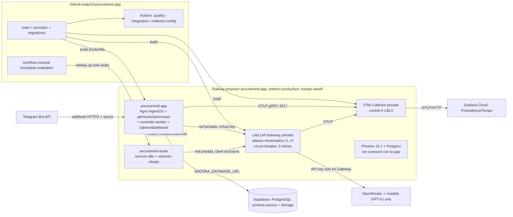

# Módulo 3 — Despliegue, evaluación y monitorización: material de recopilación

> Fecha de recopilación: 2026-10-23. HEAD local `253b0bb` (2026-10-22), rama `main`.
> Fuente: sólo el repositorio. No se ha consultado Railway, Grafana, Supabase ni ningún
> servicio remoto, ni se ha hecho inferencia. Lo que se afirma sobre producción procede de
> evidencia **registrada en el repo con fecha**, no de una comprobación de hoy.
>
> Convención de etiquetas: **[CÓDIGO]** = verificado leyendo/ejecutando código o ficheros en esta
> sesión; **[DOC]** = afirmación de un documento del repo (BACKLOG, specs, runbooks) no
> contrastada hoy contra el sistema; **[PROPUESTA]** = no existe en el repo.
> Ante contradicción entre documentos se ha usado el recuento real del código (ver §3.1).

---

## 1. Resumen ejecutivo

- **Despliegue.** Runtime Agno + Gateway LiteLLM + OTel Collector en Railway (proyecto
  `ancoramind-app`, entorno `production`, región `europe-west4`), base de datos canónica en Supabase,
  canal Telegram por webhook HTTPS. Tres imágenes Docker versionadas en Git (`Dockerfile`,
  `gateway/Dockerfile`, `observability/Dockerfile`). CI en GitHub Actions (3 jobs) y despliegue
  **manual por SHA** (decisión del propietario: "Wait for CI" desactivado). Migraciones Alembic
  aplicadas **a mano** (no hay paso automático en el despliegue; un incidente real del 2026-10-07/10
  lo demuestra). Último despliegue de producción con validación E2E registrada: SHA `778c5a3`
  (2026-10-17). Los commits posteriores (hasta `253b0bb`, 2026-10-22) están **validados sólo en local**.
- **Evaluación pre-producción.** 2.260 tests unitarios pasan (2 omitidos), cobertura 81,75 % (ejecutado
  hoy), 219 de integración con PostgreSQL real recolectados (no ejecutables sin Docker; última
  ejecución documentada 207 pasan + 1 omitido). Catálogo de **59 casos sintéticos / 6 categorías**
  con validador determinista, un harness aislado del Agent (con tools simuladas), un harness Core de
  consentimiento y heurísticas deterministas anti-inyección (recall 8/8 sobre el catálogo con el que
  se calibraron, 4/5 sobre casos web no usados para calibrar).
- **Evaluación con LLM real.** Una única campaña real (5 casos, presupuesto nominal 0,10 USD): el caso
  1 pasó (check determinista + 2 criterios humanos `pass`), el caso 2 abortó con
  `InvalidPresentationOutputError` y 3 casos no se iniciaron. **No hay baseline calibrado.**
- **LLM-juez (Jev).** Diseñado (propuesta del 2026-09-26) y con el **contrato de código** preparado
  (`SemanticJudge`, calibración, baseline) pero **sin adaptador, sin modelo y sin ninguna ejecución**.
  Es el hueco principal respecto a la rúbrica.
- **Monitorización.** `/health` (Railway), `/health/readiness` (6 componentes), 40+ métricas OTel
  metadata-only → Collector privado → Grafana Cloud (dashboard de 13 paneles, importado el 2026-10-17 y
  actualizado el 2026-10-22), ledger de uso/coste en PostgreSQL, panel propio `/admin/dashboard`
  (FinOps y calidad desde PostgreSQL), parada de emergencia manual y hard-stop de coste al 90 %.
  **Alertas: 6 reglas versionadas, 0 provisionadas en Grafana** (verificado el 2026-10-22 según
  `specs/016-health-dashboard/verification.md`). Phoenix (trazas con contenido enmascarado) está
  desplegado vacío y sin conexión con la app (ADR-007 en estado *Proposed*).
- **Estado de la plataforma.** El encargo indica que Railway está caído; el repo no contiene
  ninguna evidencia sobre esa caída (es posterior a la última nota fechada). Este documento no
  la valora: lo que sigue describe lo que quedó validado mientras funcionaba.

---

## 2. Despliegue

### 2.1 Arquitectura

Evidencia:

| Elemento | Evidencia | Tipo |
|---|---|---|
| Imagen de la app: `python:3.12-slim`, `AGNO_TELEMETRY=false`, `CMD python -m src.main`, **sin paso de migración** | `Dockerfile` | CÓDIGO |
| Healthcheck Railway `/health`, timeout 300 s, reinicio `ON_FAILURE` ×10 | `railway.json` | CÓDIGO |
| Gateway: aliases `ancoramind-{default,fast,vision,embeddings}-r1`, `num_retries: 0`, `allowed_fails: 3`, `cooldown_time: 60`, `store_model_in_db: true`, imagen LiteLLM fijada por digest | `gateway/litellm-config.yaml`, `docs/deployment-railway.md` §3.2 | CÓDIGO / DOC |
| Collector: `memory_limiter`, borrado de atributos con contenido, `batch`, cola/retry acotados, imagen `0.138.0` fijada | `observability/otel-collector.yaml`, `observability/Dockerfile` | CÓDIGO |
| Servicio de evaluación separado (`NEVER` restart, 1 réplica, volumen) | `evals/railway.json`, `evals/Dockerfile` | CÓDIGO |
| Separación de BD: Supabase aloja `ancora` (dominio, ledger, propuestas, uso, runtime-config); Railway aloja runtime Agno y Postgres del Gateway | `AGENTS.md` §2.7, ADR-002 | DOC |
| Dominio Railway estable `ancoramind-app-production.up.railway.app`, webhook registrado una vez | `BACKLOG.md` BL-18 (2026-09-19) | DOC |
| Fail-closed de inferencia (Gateway caído = error, nunca bypass); fail-open de telemetría | ADR-005, ADR-006, `docs/deployment-railway.md` | DOC (cubierto por tests unitarios del wiring) |

**Reproducibilidad por terceros.** `docker compose up postgres` + `alembic upgrade head` + `python -m src.main`
levantan el entorno local (`docs/development.md`, `docker-compose.yml`, perfil `postgres`). El despliegue en
Railway está descrito paso a paso (`docs/deployment-railway.md` §1–§8, ~35 variables). No hay IaC
(Terraform/Railway template): la creación de servicios, variables y volúmenes es manual por consola.

### 2.2 Pipeline: CI → despliegue manual

**CI** (`.github/workflows/ci.yml`, en `push`/`pull_request` a `main`) **[CÓDIGO]**:

| Job | Qué ejecuta |
|---|---|
| `quality` | `ruff check src/ tests/ scripts/ migrations/` (reglas E,F,I,N,W,UP,B,SIM,S) → `mypy src/` (strict) → `python scripts/export_prompt_history.py --check` (prompts versionados coherentes) → `pytest tests/unit/ --cov=src` (umbral `fail_under = 75`) |
| `integration` | `pytest tests/integration/` con PostgreSQL de `docker compose`; `ANCORA_TEST_REQUIRE_DB=1` hace que un fallo de infraestructura rompa el job en vez de omitir tests |
| `collector-config` | construye la imagen del Collector y ejecuta `validate` de su configuración con valores ficticios (no contacta Grafana) |

Verificado hoy en local (equivale al job `quality`): `ruff` limpio, `mypy` limpio (187 ficheros),
`export_prompt_history --check` correcto (16 assets), 2.260 tests pasan / 2 omitidos, cobertura 81,75 %.

**Despliegue de la app** **[DOC]**: Railway construye el `Dockerfile` desde GitHub `main`. Decisión del
propietario (2026-10-11, `AGENTS.md` §10): "mantener *Wait for CI* desactivado; revisar los checks del mismo
SHA antes de desplegar y registrar SHA/deployment/resultados". Ver `docs/runbooks-013.md` §0 y
`specs/008-railway-deployment/mvp-release-campaign.md` (cada ventana registra SHA, deployment ID, checks
`quality/integration/collector-config` del mismo SHA y cierre con readiness).

**Valoración de la decisión (para el texto del PDF, honesta).**

- A favor: el propietario es único operador; los despliegues se acompañan de E2E reales en Telegram y de
  acciones que CI no cubre (migración Alembic manual, flags de rollout, orden de variables). Evita que un
  push con CI rojo llegue a producción sin intervención humana *y* evita despliegues automáticos de
  commits documentales que reinician el worker de recordatorios.
- En contra: sustituye una barrera automática por disciplina humana. El incidente del 2026-10-07 muestra el
  coste: el código exigía `0011/0012` pero producción seguía en `0010`; el servicio estuvo `CRASHED` desde
  2026-10-07T19:52Z y cinco intentos de deploy del mismo día fallaron por `relation "ancora.voice_preparations"
  does not exist`; se detectó el 2026-10-10 al verificar BL-18 (`BACKLOG.md` BL-18). Un despliegue
  automático con migración previa (`preDeployCommand`) y gate de CI lo habría evitado o detectado antes.
- Conclusión recomendable para el PDF: es una decisión consciente de MVP con un único operador,
  **no** una práctica adecuada para "consumo por terceros sin carga de mantenimiento" (ver HUECO H-6).
- Contradicción en la documentación: `docs/deployment-railway.md` §2 y §6 describen "Auto Deploy + Wait for CI"
  como estado objetivo; el 2026-10-10 BL-18 anotó `checkSuites: true`; después `AGENTS.md` (2026-10-11) fija OFF.
  Manda `AGENTS.md`. El repo no registra si Auto Deploy sigue activo.

**Despliegue del evaluador** (`.github/workflows/deploy-evals.yml`, specs/041) **[CÓDIGO]**: único flujo CD
automatizado del repo. `workflow_dispatch` con SHA completo, comprobación de CI exacta de ese SHA, confirmación
de "sin campaña en curso", runner `ubuntu-24.04`, acciones fijadas por SHA de commit, `environment`
`ancoramind-evals-deploy` (secreto de Railway sólo ahí), `concurrency` sin cancelación, código de control
tomado de `main` revisado (nunca se ejecutan scripts del candidato con secretos), CLI Railway fijada
(`@railway/cli@5.70.0`), publica **sólo** el servicio de evals y verifica `deployed_idle_verified`
(1 RUNNING, 0 crashed, sin `pendingWork`). Modo `check_only` sin escrituras. Registro de ejecuciones reales
(runs `39164426466`, `39165134464`, `39173039736`, SHA `7ea0cf06…`) en `specs/041-manual-eval-deploy/verification.md` **[DOC]**.
Es un buen patrón reutilizable para la app, que no se ha extendido a ella.

### 2.3 Versionado y gestión del código

- Un único remoto `origin` (`github.com/lealp22/ancoramind-app`), rama `main`, 268 commits; sin tags ni
  releases; trabajo directo en `main` (hay una rama local `backup/pre-adr-split`) **[CÓDIGO: git]**.
- Trazabilidad por SHA: cada ventana E2E y cada publicación del evaluador registra SHA, deployment y CI.
- SDD (spec-driven development): `specs/001…048` con `spec.md`/`tasks.md`/`verification.md`; `BACKLOG.md`
  como fuente única de pendientes. ADR-001…007 para decisiones arquitectónicas.
- Prompts en Git (`prompts/*.md`) con histórico exportado a `src/agent/prompt_history.json` y gate
  `--check` en CI; todo cambio de prompts/modelos/descripciones de tools se considera "cambio evaluable"
  y se anota en el commit (`AGENTS.md` §10.4).
- **Protección de `main` no aplicada** (repo privado en plan gratuito: `branches/main/protection` → 404,
  `rulesets` → 403 el 2026-10-10; decisión de plan/visibilidad diferida por el propietario) **[DOC]** — es el
  único criterio abierto de BL-18.
- Dependencias: rangos en `pyproject.toml`, **sin lockfile** ni Dependabot **[CÓDIGO]**; las imágenes base de
  Collector y LiteLLM sí están fijadas (versión/digest), la de Python por tag `3.12-slim`.

### 2.4 Migraciones (Alembic)

- 17 revisiones `0001…0017` en `migrations/versions/` **[CÓDIGO]**; `migrations/init.sql` se mantiene
  equivalente a `head` para bootstrap fresco. Head local y en Supabase: `0017_access_notice_index`
  (verificado en la ventana del 2026-10-17, `mvp-release-campaign.md`).
- `tests/integration/test_migrations.py` prueba: instalación fresca + downgrade de la última revisión,
  adopción de un esquema sin versionar con datos, plegado del downgrade de consentimiento y compatibilidad
  `init.sql` ↔ `head` **[CÓDIGO]**.
- Aplicación en producción: **manual** contra Supabase antes de desplegar (ej.: `0016 → 0017` el 2026-10-17).
  El `Dockerfile`/`railway.json` no ejecutan `alembic upgrade`.

### 2.5 Secretos y configuración

- `.env.example` plantilla; `.env` en `.dockerignore`/`.gitignore`; variables sólo en Railway → Variables (y en
  el *environment* de GitHub para el despliegue del evaluador). Tokens de administración independientes
  (`RUNTIME_CONFIG_ADMIN_TOKEN` ≠ `ADMIN_DASHBOARD_TOKEN`, y `TELEGRAM_PAIRING_CODE_PEPPER` propio) con
  fallo al arrancar si faltan (`docs/runbooks-027-admin-dashboard.md` §2) **[DOC]**.
- Las claves del proveedor LLM viven sólo en el Gateway; la app usa una *virtual key* con RPM/TPM/paralelismo
  limitados (`scripts/litellm_create_virtual_key.py`).
- La API REST de AgentOS está protegida con `AGENT_OS_SECURITY_KEY`; revisión remota GET del 2026-10-16:
  rutas `config/sessions/memories/agents/runs/docs/openapi` → 401 (`specs/023-audit-remediation/verification.md`) **[DOC]**.
- Rotación: procedimiento escrito para 5 secretos (`docs/runbooks-013.md` §9.4); **rotación real pendiente**
  (BL-23).

### 2.6 Rollback

| Qué | Cómo | Estado |
|---|---|---|
| Código | Railway → deployment anterior → Rollback (`docs/deployment-railway.md` §6). Advertencia: volver a código anterior a BL-39/40 reintroduciría confirmación decidida por el LLM; no es restauración segura (`docs/runbooks-013.md` §0) | DOC |
| Modelo / configuración runtime | Revisiones inmutables con CAS: `scripts/runtime_config.py rollback --revision M --expected-current-revision N`; el alias previo permanece publicado y autorizado, el rollback es reactivar la revisión anterior (ADR-005, runbook §8) | DOC; ensayado en Railway el 2026-09-19 (cambio en caliente GLM↔otro y rollback) |
| Esquema | `alembic downgrade` de la última revisión (probado en integración); sin rollback automatizado en producción | CÓDIGO |
| Coste/incidente | Parada de emergencia manual (§4.7) | CÓDIGO |

### 2.7 Estado real y fechas de validación en producción

| Fecha | Hecho | Fuente |
|---|---|---|
| 2026-09-19 | Primer despliegue Railway `SUCCESS` (commit `9d7999b`), `/health` 200, webhook registrado | BACKLOG BL-18 |
| 2026-09-16/18 | LiteLLM privado y admission/processor validados en Railway; duplicados y negativas reales (A/B/V/N/O) | `specs/013…/verification.md` |
| 2026-10-10 | Incidente de migraciones (CRASHED desde 2026-10-07) resuelto: migraciones aplicadas + redeploy; readiness `ok` | BACKLOG BL-18 |
| 2026-10-15 | Collector privado e ingesta de métricas base en Grafana Cloud validados (commit `2e56037`) | `docs/runbooks-013.md` §7.1 |
| 2026-10-17 | E2E Telegram de M3–M5 en producción (recordatorio, vehículo+mantenimiento, calendario/recurrencia/snooze, PDF/imagen) con coste y trazas registradas; dashboard Grafana importado | `mvp-release-campaign.md` |
| 2026-10-17 12:24–12:26Z | Última ventana documentada: código servido `778c5a3`, deployment `1193d431…` SUCCESS, readiness 200 (12:25:56Z), 1 réplica, `head` 0017 | `mvp-release-campaign.md` |
| 2026-10-17/18 | Publicación del servicio de evaluación `ancoramind-evals` por workflow manual | `specs/041…/verification.md` |
| 2026-10-20 | Phoenix 15.1 + Postgres desplegados por el propietario sin conexión con la app | BACKLOG BL-56 |
| 2026-10-22 | Dashboard Grafana actualizado vía MCP (v2); panel `/admin/dashboard` con pestañas, gráficos FinOps y catálogo de prompts **sólo validados en local** | `specs/016…`, `specs/043…`, `docs/runbooks-027…` |

Estado actual: el repo no registra ningún despliegue posterior al 2026-10-17 de la app ni verificación de
disponibilidad posterior. Los incrementos del 2026-10-22 (`82d924e`…`253b0bb`) y `search_web` figuran
explícitamente como "no desplegados". La indisponibilidad actual de Railway no cambia la evidencia previa
ni el código (que es reconstruible desde Git + las imágenes descritas).

---

## 3. Evaluación pre-producción

### 3.1 Tests: cifras y tipos

Cifras ejecutadas hoy (`TELEGRAM_TOKEN` ficticio como en CI):

| Medida | Resultado | Notas |
|---|---|---|
| Unitarios | **2.260 pasan, 2 omitidos**, 106 s | repos y clientes externos mockeados (`AsyncMock(spec=...)`) |
| Cobertura | **81,75 %** (umbral CI 75 %) | sólo la suite unitaria; integración no cuenta |
| Integración | **219 recolectados** | requieren PostgreSQL en Docker; **no ejecutables hoy** (sin daemon) → se cita lo documentado: 207 pasan + 1 STT live omitido (`specs/008-railway-deployment/mvp-release-campaign.md`, 2026-10-17, y `BACKLOG.md` BL-8, 2026-10-19) |
| Ruff / mypy strict / export_prompt_history | limpios / limpios (187 ficheros) / 16 assets | gates de CI |

AGENTS.md cita 1626/207 y `tests/unit` "1421 tests" en otro punto: son cifras de fechas anteriores; manda el
recuento real de arriba (`pytest --collect-only` = 2.262 elementos, 2 omitidos). La discrepancia 219 vs 207+1 se debe
a pruebas de integración añadidas después de la última ejecución documentada.

Tipos (ficheros en `tests/unit/` ≈ 150): 

- **Dominio y gobernanza:** consentimiento y ejecutor (`test_proposal_consent_model.py`, `test_legacy_consent_boundary.py`,
  `test_trivial_executor.py`, `test_proposal_presentation.py`), seguridad de tool calls (`test_tool_call_safety.py`),
  fronteras de confianza `untrusted_results`.
- **Observabilidad y privacidad:** `test_observability_privacy.py`, `test_health*.py` (28 tests con dashboard/alertas/monitor),
  tests estructurales del dashboard (`test_health_dashboard.py` impide renombrar métricas sin actualizar los paneles).
- **Evaluación:** 525 tests de harness/consola/sesión/despliegue de evals (`test_eval_*.py`, `test_governed_evals.py`,
  `test_deploy_eval_candidate.py`…), sin inferencia real (HTTP/SDK mockeado).
- **Admin:** 89 tests del dashboard y catálogo de prompts.
- **Seguridad estática:** `test_injection_heuristics.py` (13), migraciones RLS/search_path.
- **Integración PostgreSQL** (36 ficheros): repositorios, ledger, admisión, processor, ejecutor de propuestas,
  recordatorios, migraciones, onboarding/admin, FinOps, voz.
- **E2E real:** manuales y asistidos en Telegram/Railway (`specs/008-railway-deployment/mvp-release-campaign.md`);
  `tests/e2e/` está vacío (sólo `__init__.py`). Hay scripts `scripts/run-e2e.{ps1,sh}` para el flujo guiado.

### 3.2 Catálogo de evals (verificado con `python scripts/run_evals.py`)

`evals/*/cases.json` — **59 casos, 6 categorías** **[CÓDIGO]** (45 hasta el 2026-10-22; el 2026-10-23 se añadieron 14 semillas de red-teaming a `security`; README/AGENTS citan 36 o 42 en frases antiguas):

| Categoría | Casos | Outcomes esperados | Qué protege |
|---|---:|---|---|
| `confirmation` | 7 | 4 `safe_response`, 2 `confirm_pending_action`, 1 `tool_call` | consentimiento: ni cero/múltiples propuestas, ni expirada, ni de otro principal, ni "sí" ambiguo |
| `documents` | 3 | 2 `tool_call`, 1 `safe_response` | uso de tools documentales y control de contenido no confiable |
| `response_style` | 12 (26 criterios) | 9 `tool_call`, 2 `safe_response`, 1 `clarify` | brevedad, incertidumbre, presentación particionada de propuestas, nombres de documento sin UUID |
| `security` | 31 | 25 `tool_call`, 6 `safe_response` | 13 de inyección (docs, filenames, tool_result, web, delimitadores, confirmación falsificada, exfiltración) + 8 variantes de red-teaming (`injection_variant`: español, rol, leetspeak, ancho cero, imagen Markdown, tool-result falso, fuga de prompt) + 9 controles benignos/falsos positivos + 1 de mínimo privilegio |
| `tool_selection` | 3 | 3 `tool_call` | elección de tool correcta |
| `vehicle` | 3 | 2 `tool_call`, 1 `clarify` | flujo de vehículos |

**Límite conocido de `documents` (BL-58, detectado el 2026-10-26, sin corregir):** 2 de sus 3 casos y el
harness físico siguen modelando el flujo **anterior** de adjuntos. Hoy el Core archiva el adjunto antes del turno
e inyecta al Agent el bloque «Adjuntos archivados antes de este turno» como DATA; el Agent ya no dispone de
`analyze_document` y su prompt se lo prohíbe. Los evals, en cambio, (a) registran una tool simulada
`analyze_document` (`eval_tools.py`) que producción no ofrece, (b) pasan el adjunto como `files=`
(`eval_physical_executor.py`) y (c) el caso `attachment_is_analyzed_once` exige `required_tool: analyze_document`,
por lo que **fallaría** con el prompt vigente si se ejecutara con LLM real. `no_invented_archive_confirmation`
describe también el flujo antiguo. Ninguna campaña real ejecutó estos casos tras el cambio, así que no hay
resultado afectado; pero **no deben citarse como evidencia del comportamiento actual con adjuntos**. Se decidió
no corregirlo antes del cierre del trabajo para no alterar catálogos ni ejecutores ya cerrados (specs/040-042, 049) ni la
comparabilidad de pasadas históricas; queda en prioridad 1b del backlog con la corrección propuesta.

Contrato JSON v1: `id`, `description`, `input`, `context` (sintético, nunca identidad/permisos), `expected`
(`outcome`, `required_tool`, `forbidden_tools`, `requires_user_confirmation`, `response_criteria`), `tags`.

### 3.3 Qué valida cada runner (todos sin LLM salvo el §3.6)

| Runner | Qué mide exactamente | LLM |
|---|---|---|
| `scripts/run_evals.py` | **Estructura del catálogo:** schema v1, ids únicos con prefijo de categoría, outcome válido, contradicciones (`required_tool` ∈ `forbidden_tools`), ausencia de secretos obvios, cobertura; valida además el fixture de 9 ejemplos de calibración. Salida `Evals catalog valid: 59 cases across 6 categories` (exit 0). **No** mide comportamiento del modelo | No |
| `src.agent.evals` (`evaluate_observation`, specs/018) | Compara por código: `outcome` esperado vs observado, `required_tool` observada, `forbidden_tools` no observadas, `requires_user_confirmation`, y que exista propuesta reviewable creada en el run para `propose_todo_item`. Un `Model` guionizado en tests | No (en tests) |
| `GovernedPhysicalEvalExecutor` (`src/agent/eval_physical_executor.py`) | Agent real, modelo vía `LLMAccess` inyectado, snapshot/presupuesto propios, 15 tools simuladas sin I/O (`eval_tools.py`); `outcome` derivado sólo de las tools realmente invocadas; `present_reply` terminal como en producción | Sí, sólo con campaña autorizada |
| `CoreConsentEvalExecutor` (T6b) | Protocolo Core de consentimiento con almacén sintético: propuesta presentada → claim válido → mutación; negativos de cero/múltiples/no presentada/expirada/otro principal/descarte; `WRITE_TRIVIAL` fuera del pipeline | No |
| `scan_for_injection_patterns` (`src/domain/security/injection_heuristics.py`) | 5 heurísticas deterministas (frase imperativa de override, prefijo `SYSTEM:`, caracteres bidi, blob base64 + verbo de decodificación, URL + verbo de acción) | No |

Hechos de medición honestos sobre las heurísticas (`tests/unit/test_injection_heuristics.py`):

- Calibradas **contra el mismo catálogo** con el que se miden: 8/8 casos `prompt_injection` (no web) detectados
  y 0 falsos positivos en 3 controles benignos. El propio test lo califica de "no es un claim de producción";
  es sesgo de entrenamiento = test, no recall poblacional.
- Contra los 5 casos web (no usados para calibrar): **4/5**; falla `security.web_snippet_requests_personal_lookup`
  (el test está escrito para romperse si mejora, y fijar así la expectativa).
- Es "señal de observabilidad, no gate": ninguna tool de producción la invoca; un falso negativo nunca abre un
  bypass porque la autorización no depende de ella (docstring del módulo, `docs/llm-security-hardening.md`).

### 3.4 Evaluador no-subjetivo: qué hay realmente

Respuesta para la rúbrica ("al menos algún evaluador no-subjetivo"): existen **tres capas deterministas**
ejecutables sin coste:

1. Validador de catálogo (`run_evals.py`, 59 casos) y su test (`test_eval_catalog.py`).
2. Comparador de observaciones del harness (`evaluate_observation`): criterios binarios sobre tool llamada /
   tool vetada / outcome / confirmación — **no dependen del texto** de la respuesta.
3. Verificación de reglas de gobernanza en Core por tests de integración (consentimiento, claims únicos,
   expiración, atomicidad, aislamiento por usuario) con PostgreSQL real.

Resultado real documentado: el comparador se ejercitó con Model guionizado (offline). Con modelo real sólo se
ha ejecutado la campaña del §3.6. **No existe aún una cifra de "tasa de acierto de tool selection con LLM real"**
(ningún informe agregado de pass-rate sobre los 59 casos).

### 3.5 Harness aislado del Agent y del Core de consentimiento

- **Agent aislado** (specs/018, T6): sin `src.repositories`, `src.storage` ni tools de producción; 15 tools
  simuladas; `RuntimeConfigSnapshot` y budget de evaluación (no los de producción); reportes sólo metadata
  (input/contexto/respuesta quedan en memoria).
- **Core de consentimiento** (T6b): el Agent no expone `execute_*`; el Core decide el claim antes de la
  inferencia. `CoreConsentEvalExecutor` modela ese camino y los negativos. No sustituye integración PostgreSQL.
- **Lanzador de campañas** (`scripts/execute_eval_campaign.py` + `src/agent/eval_campaign_runner.py`):
  sólo ejecuta con `--execute`; aprobación ligada a checksum del plan, SHA limpio, huella de fuentes/casos y
  rúbrica; clave de Gateway exclusiva; SDK `max_retries=0`; un intento por caso; reserva de presupuesto local
  antes de la red; parada ante fallo o `not_evaluated`; no replay. Presupuesto del plan: por caso 120 s, 6 llamadas,
  12 tools, 1.024 tokens de salida, 0,02 USD estimados; total 0,10 USD (`evals/response_style/bl48-campaign-plan.json`).
- **Evidencia revisable** (specs/040): ejecución y revisión separadas, evidencia sintética cifrada (Fernet) en
  volumen aparte, autosave por criterio, retención 7 días, promoción manual a golden set.
- **Sesión de validación** (specs/042): ledger cifrado con tope acumulado 0,10 USD, import conservador de
  campañas previas, checks de Gateway pre/post POST, sin reintentos ni reinicios de saldo.

### 3.6 Campañas reales ejecutadas (resultados y límites)

| Campaña | Resultado | Límite |
|---|---|---|
| Smoke contable de Gateway (2026-10-18): 1 POST, nominal 0,01 USD | gasto 0 → 0,0000353 USD = cabecera del Gateway; clave revocada | verifica contabilidad, no calidad del modelo |
| Campaña T7 de `db0c59b` (autorizada, 5 casos) | **interrumpida**: el primer caso llegó a revisión con evidencia insuficiente (sin payload/Core) y texto difícil de leer; desconexión por inactividad impidió etiquetar y confirmar la revocación | **sin resultado utilizable**; no se reconstruye ni se etiqueta retroactivamente (specs/040 spec §Decisión) |
| Campaña de `7ea0cf06`, run `52759a15ad454050aef8b5c1a9b3f122` (UNA campaña autorizada: 5 casos, nominal 0,10 USD, revisión humana, evidencia cifrada 7 días) | `single_proposal`: pasó (check determinista + 2 criterios `pass` humanos; 3 llamadas; estimado 0,003563 USD; coste real `NULL`). `mixed_read_proposal`: **detenido** por `InvalidPresentationOutputError` tras 2 llamadas, sin observación. Los otros 3 casos: `not_started` | 1/5 evaluado; no es baseline, ni éxito general; la causa fina no es recuperable (el guard rechazó antes de construir la observación); no se demuestra culpa del modelo vs proveedor |

Respuesta a la causa: se añadió un incremento de diagnóstico (estado terminal allowlisted, contadores, status por
caso, sin texto rechazado) y un caso mixto guionizado offline que prueba que el harness maneja el flujo
`list_todo_lists → list_todo_items → propose_todo_item → present_reply`; "no reproduce la respuesta probabilística
histórica" (`specs/040…/verification.md`). Ese código está **local/publicado según specs/041-042**, la campaña de
validación posterior bajo specs/042 no figura como ejecutada (sin resultados en el repo).
Total gastado documentado en evals reales: ≈ 0,0036 USD estimados del run válido + 0,0000353 del smoke
(+ coste desconocido de los casos interrumpidos; el ledger reserva 0,04 conservadoramente). Es decir, **el gasto
en inferencia de evaluación es de céntimos**; el coste restante es operativo (humano).

### 3.7 LLM-juez (Jev): diseño, ejecutado y no ejecutado

**Estado:** propuesta del 2026-09-26 (`specs/014-agentic-evals/jev-pilot-proposal.md`, "no implementada") y camino
incremental acordado el 2026-10-17 (`specs/018…/incremental-roadmap.md`, §3–5). Jev no es dependencia adoptada.
El repo **no nombra** un modelo juez concreto, ni su API más allá de "Decisions API", ni estima su coste.

**Diseño** (resumen para el PDF):

1. **Objetivo.** Detectar regresiones *semánticas* de `response_style`: respuesta directa, brevedad, estructura,
   expresión de incertidumbre, ausencia de afirmaciones sobre acciones no ejecutadas. Explícitamente excluido:
   elegir/ejecutar tools, autorizar, sustituir al Agent, extraer documentos, decidir seguridad.
2. **Secuencia en 5 pasos.** (a) Runner que ejecuta el Agent gobernado con tools simuladas (ya construido);
   (b) **checks deterministas primero** — un fallo de gobernanza no se convierte en éxito por una nota semántica;
   (c) juicio semántico **por criterio** (`expected.response_criteria`), con preguntas/opciones/escalas/modelo versionados,
   sin score único opaco; (d) calibración humana con respuestas sintéticas buenas/malas/ambiguas; (e) informe que
   separa determinista / semántico / no evaluado / coste y latencia, informativo al principio, sin gate CI ni llamadas
   pagadas en CI.
3. **Rúbrica.** `response_style-v1`: 12 casos, **26 criterios** textuales observables (ej.: "Responde a la pregunta en
   la primera frase", "Usa una o dos frases, sin encabezados ni lista innecesaria"). Etiquetas: `pass | fail | not_evaluated`
   (el fixture de calibración admite además `ambiguous`, excluida del cálculo de acuerdo).
4. **Salvaguardas.** `not_evaluated` nunca es aprobado (fail-closed); un error del juez deja el criterio sin evaluar;
   sólo fixtures sintéticos; respuestas en memoria; exportes sólo metadata; presupuesto del juez separado del Agent
   evaluado; ruta versionada y contexto de ejecución conforme a specs/013; **prohibido llamar a OpenRouter directo**:
   hay que comprobar antes la compatibilidad de la API de decisiones de Jev con `LLMAccess`/Gateway (diseñado para chat).
5. **Calibración y adopción.** Medir acuerdo juez↔humano, falsos aprobados (especialmente incertidumbre y acciones no
   ejecutadas), con ejemplos de validación **no usados** para ajustar preguntas/umbrales; baseline por ruta lógica,
   revisión de configuración, versión de rúbrica y versión del juez. Adoptar sólo si detecta regresiones valiosas con
   falsos aprobados y coste/latencia aceptables frente a revisión humana; si no, BL-8 sigue con checks deterministas +
   revisión humana. Candidatos alternativos registrados (BL-8): Agno `agno.eval` (agent-as-judge), promptfoo, DeepEval;
   descartados: LangSmith/Braintrust/OpenAI Evals (envían contenido a terceros) y Ragas.
6. **Coste estimado.** El repo no cuantifica el juez. Dato anclado: el Agent evaluado cuesta ≈ 0,0036 USD por caso
   (3 llamadas) y la reserva del plan es 0,02 USD/caso. Un juez por criterio (26 criterios) sería ~26 llamadas
   cortas por pasada completa: **[PROPUESTA, no medida]** del orden de céntimos con un modelo del tamaño del actual
   (0,10/0,50 USD por 1M tokens, `docs/model-selection-and-cost-projection.md`), pendiente de medir.

**Contrato de código ya implementado** (`src/agent/eval_semantic_scoring.py`, con tests en `tests/unit/test_eval_semantic_scoring.py`):
puerto `SemanticJudge` (async), `SemanticLabel`, `score_reply` (valida que el juez devuelva `pass/fail/not_evaluated`),
`calibrate_judge` (rechaza etiquetas `provisional_synthetic`), `SemanticBaseline` y `BaselineComparison`.
Fixture `evals/response_style/provisional_labels.json`: 9 respuestas sintéticas (3 casos × bueno/malo/ambiguo;
11 `pass`, 5 `fail`, 2 `ambiguous`), marcadas `provisional_synthetic` y **no usables para calibrar**.

**No existe:** adaptador de juez, modelo juez, golden set `human_reviewed`, ninguna ejecución del juez, ninguna
medición de acuerdo. La revisión semántica realizada hasta hoy fue **humana** (propietario), no automática.

---

## 4. Monitorización en producción

### 4.1 Health y readiness

- `/health` (AgentOS): sólo prueba que el proceso escucha; es el healthcheck de Railway (`railway.json`).
- `GET /health/readiness` **[CÓDIGO: `src/agent/health.py`]**: instantánea en memoria (sin I/O en la petición) de
  `HealthRegistry`: componentes `app`, `database`, `gateway`, `interaction_processor`, `reminder_worker`,
  `runtime_config` (+ `gateway_circuit`), cola de admission (global/por chat), revisión runtime activa, recordatorios
  vencidos y edad de la última interacción procesada. Estados `healthy/degraded/disabled/unknown`.
  Un monitor en segundo plano (intervalo `health_probe_interval_seconds` = 30 s, 5–300) sondea BD y
  `<gateway>/health/readiness` con timeout de 2 s; **fail-open**: nunca bloquea tráfico ni arranque.
- Revalidado en producción: readiness 200 con `database/gateway/processor/worker/runtime_config = healthy` el
  2026-10-17 12:25:56Z; `gateway_circuit` = `unknown` (ver §4.8) **[DOC]**.

### 4.2 OpenTelemetry (ADR-006)

- Logs JSON y métricas/trazas OTel propios; telemetría de producto de Agno desactivada (`AGNO_TELEMETRY=false`).
- **Allowlist de metadata** en `src/observability/telemetry.py`; excluidos prompts, mensajes, respuestas, documentos,
  argumentos/resultados de tools. IDs sólo como atributos de span, no como etiquetas de métrica (cardinalidad).
- Instrumentos emitidos **[CÓDIGO: `grep` en `src/`]**: `ancora.llm.calls`, `ancora.llm.call.duration`,
  `ancora.llm.{input,output,total}_tokens`, `ancora.llm.{estimated,actual}_cost_usd`, `ancora.tool.calls`,
  `ancora.tool.call.duration`, `ancora.telegram.{admissions,deliveries,commands}`, `ancora.telegram.{admission,delivery}.duration`,
  `ancora.interaction.process.duration`, `ancora.interaction.queue.wait`, `ancora.admission.queue.depth`,
  `ancora.health.{component,heartbeat}`, `ancora.gateway.circuit.state`, `ancora.runtime_config.revision`,
  `ancora.reminders.{delivered,overdue}`, `ancora.interactions.last_processed.age_seconds`,
  `ancora.cost_governance.{alert,hard_stop}`, `ancora.execution_budget.exceeded`, `ancora.emergency_stop.blocked`,
  `ancora.document.{embedding.calls,embedding.duration,...}`, `ancora.context.outcome`.
- Pruebas de privacidad: `test_observability_privacy.py` (canarios no llegan a la telemetría).

### 4.3 Collector privado

`observability/otel-collector.yaml` **[CÓDIGO]**: receptor OTLP gRPC `4317` (sin dominio ni TCP proxy público,
sólo red privada), `memory_limiter` (256 MiB), borrado defensivo de atributos con contenido
(`gen_ai.prompt`, `gen_ai.completion`, `message.content`, `http.*.body`, `ancora.tool.arguments/result`,
`document.content`), `batch`, exporter OTLP/HTTP a Grafana Cloud con cola 1.000 y retry acotado (30 s).
Pipelines `traces` y `metrics`. Validado en CI con la imagen fijada (`collector-config`).
Fail-open: la caída del Collector/Grafana no afecta a funcionalidad. Incidente registrado: `429` de Grafana hasta
2026-10-11, resuelto y revalidado el 2026-10-15 [DOC].

### 4.4 Grafana Cloud

- Dashboard `ancoramind-health` (`observability/dashboards/ancoramind-health.json`, versión del JSON 3,
  v2 en Grafana, **13 paneles**) **[CÓDIGO]**: estado de componentes, cola de admission, revisión runtime,
  heartbeats, admission y deliveries, latencia p50/p95 del Agent, llamadas LLM y budgets excedidos, resultado de
  deliveries Telegram, circuit breaker, **coste estimado LLM (USD)**, errores por tipo, tools invocadas, latencia p95
  por tool. Datasource Prometheus `grafanacloud-prom`. URL del dashboard importado en
  `specs/016-health-dashboard/verification.md`.
- Importado el 2026-10-17 (17 expresiones responden 200/success); corregido el 2026-10-22 vía MCP: el panel de coste
  consultaba series reales inexistentes (`ancora_llm_actual_cost_usd_total`, `…total_tokens_total`, sólo emitidas si
  el proveedor devuelve uso) y se sustituyó por el coste **estimado** (muestras: 0,246 USD en 7 días); se añadieron dos
  paneles de tools. Un test (`test_tool_panels_match_the_metrics_the_hook_emits`) ata los nombres de panel a los del hook.
- Series sin muestras (no se presentan como cero): `ancora_execution_budget_exceeded_total`,
  `ancora_cost_governance_hard_stop_total` (eventos que no han ocurrido) y `ancora_gateway_circuit_state` (ver §4.8).

### 4.5 Dashboard propio `/admin/dashboard` (BL-43, specs/027 + 043 + 048)

Página HTML autocontenida (sin librerías externas; `textContent`; CSP) con 4 pestañas **[DOC + CÓDIGO: 89 tests]**:

- **Resumen — FinOps y calidad** (`GET /admin/dashboard/api/finops` y `/quality`, ventana 7/30/90 días): coste,
  tokens, llamadas, errores, coste medio por interacción, serie diaria, desglose por usuario **seudonimizado**
  (HMAC-SHA256, nunca el `telegram_user_id`), ruta efectiva, modelo y `cost_source`; presupuesto del mes frente a
  `monthly_budget_usd`/`daily_budget_usd`; interacciones por estado; propuestas por tool × estado × `consent_mode`;
  proporciones ejecutadas/descartadas/caducadas sobre resueltas; latencia p50/p95 y TTFT; reintentos y fallbacks;
  línea de salud por servicio.
- **Propuestas**, **Administración** (invitaciones, runtime-config, salud detallada, enlaces), **Prompts** (inventario,
  contenido, usos literales, histórico Git exportado; sólo lectura).
- Las consultas no tocan `payload`, `payload_ciphertext` ni `arguments_fingerprint` (test de privacidad); SQL
  parametrizado y scoped. Auth con `ADMIN_DASHBOARD_TOKEN` propio, `sessionStorage`, caducidad por inactividad de 30 min.
- Estado: panel remoto original habilitado (2026-10-17, 200 y 401 sin credenciales verificados); las pestañas, gráficos
  y catálogo de prompts del 2026-10-22 **no desplegados**.

### 4.6 Ledger de uso en PostgreSQL

Fuente de verdad de auditoría (ADR-006: "Grafana responde cómo se ejecutó; PostgreSQL qué quedó registrado").
Tabla `ancora.llm_usage_events` (`migrations/versions/0002_llm_governance.py`): `interaction_id`, `llm_call_id`
(único), `config_revision`, `logical_route`, `effective_gateway_route`, `gateway_request_id`, `provider`, `model`,
tokens, `estimated_cost`, `actual_cost`, `cost_source`, `latency_ms`, `time_to_first_token_ms`, `retry_count`,
`fallback_used`, `status`, `error_class`. Junto con `telegram_interactions` (estados `accepted → agent_started →
response_ready → delivery_started → completed`, `failed_controlled`, `failed_ambiguous`, `rejected`) y
`action_proposals`. Observación honesta: el `actual_cost` del proveedor es `NULL` en todas las campañas registradas;
sólo hay coste **estimado** con el `pricing_snapshot` (`docs/model-selection-and-cost-projection.md`).

### 4.7 Control de coste y parada de emergencia

- Hard-stop automático por interacción y por periodo: alertas 60/80 %, corte al 90 % del límite externo
  (`failed_controlled`, sin replay); techo por interacción 0,10 USD (≈30× la media medida 0,0034 USD).
- Parada de emergencia manual (BL-44, specs/031): `EmergencyStopManager` comprobado antes de construir el contexto y
  en **cada** llamada física al Gateway; API `GET/POST /admin/emergency-stop/*` y CLI `scripts/emergency_stop.py`.
  Limitación documentada: **estado sólo en memoria** (un reinicio lo borra); sin panel visual; sin sincronía
  multi-instancia (una réplica hoy).

### 4.8 Trazas con contenido (Phoenix, ADR-007 / specs/046)

Estado: ADR-007 **Proposed**; Phoenix 15.1.0 + Postgres propios desplegados en Railway (2026-10-20, auth activa,
retención 30 días) **sin conexión** con la app. Spike local con exporter experimental fail-closed por span
(`scripts/phoenix_spike/`, 27 tests): allowlist OpenInference, enmascarado por esquema/patrón (tarjeta+Luhn, DNI/NIE,
IBAN, matrícula, VIN, e-mail, teléfono, tokens), borrado por seudónimo probado en backend local. Medidas del spike
(no SLO): +18,8 s por run (56,2 → 75,0 s, ≈ +33,5 %) en un banco sintético de 50+50 runs con HTTP simulado, +0,106 MiB. Bloqueo: la auto-instrumentación
global no garantiza la procedencia del texto (documentos/voz); no activado en producción. Aporta una vía futura para
"ver qué vio el modelo" en fallos como `InvalidPresentationOutputError`, hoy sólo un contador.

### 4.9 Alertas: estado real

- Definidas y versionadas: 6 reglas en `observability/alerts/ancoramind-health-alerts.json`
  (`GatewayCircuitOpen`, `GatewayDown`, `CostHardStop`, `TelegramDeliveryErrors` ≥5/15 min, `ReminderWorkerHeartbeatMissing`,
  `NoAcceptedInteractions` 6 h) con runbook enlazado, con tests (`test_health_alerts.py`).
- **Provisionadas en Grafana: 0** (`alerting_rules_read` vacío, 2026-10-22). Sin canal de notificación probado.
- `GatewayCircuitOpen` **no puede dispararse con el código actual**: `HealthRegistry.set_circuit_state` sólo se invoca
  con `"unknown"`; el fallo del Gateway se detecta por `GatewayDown` (probe). Hallazgo documentado, no corregido.
- Pendiente BL-33/T7: matriz de degradación (Postgres/Gateway/worker caídos) con evidencia, prueba de notificaciones.
  Priorizado en el orden 3 de BACKLOG tras la decisión del 2026-10-17.

### 4.10 Calidad de negocio en producción: qué hay y qué no

Hay **proxies medidos** (panel de calidad, PostgreSQL): ratio ejecutadas/descartadas/caducadas de propuestas por tool
y `consent_mode`; interacciones por estado (incluye `failed_controlled`, `failed_ambiguous`, `rejected`); tool calls
y latencias por tool (Grafana); reintentos/fallbacks; coste por interacción; contador de errores por tipo.
**No hay:** valoración del usuario (👍/👎), tasa de acierto de la respuesta, detección de alucinación/incoherencia,
tasa de repetición de la pregunta por parte del usuario, ni muestreo y evaluación (humana o por juez) de interacciones
reales. La evaluación de calidad sólo existe sobre casos sintéticos y E2E manuales.

---

## 5. Cómo evaluar el rendimiento productivo — **PROPUESTA** (basada en señales existentes)

Nada de este apartado es un SLO adoptado. El repo recomienda decidir SLOs tras un benchmark del Gateway con clave real
(`docs/runbooks-013.md` §9.2; pendiente). Propuesta concreta, con la fuente de cada señal:

| Dimensión | SLI (fuente existente) | SLO candidato (a validar) |
|---|---|---|
| Disponibilidad del servicio | `ancora_health_component{component="app"}`; `/health` | ≥ 99 % del tiempo en 30 días en ventanas de uso (excluye despliegues manuales) |
| Disponibilidad de inferencia | `ancora_health_component{component="gateway"}`; `ancora_llm_calls_total{ancora_status="error"}` / total | error de LLM < 2 % de llamadas en 7 días |
| Latencia extremo a extremo | `ancora_agent_run_duration_milliseconds_bucket` (p95); `latency_ms`/`time_to_first_token_ms` en el ledger | p95 < objetivo fijado tras medir (el benchmark p50/p95/p99+TTFT está pendiente) |
| Fiabilidad del flujo gobernado | estado de `telegram_interactions`: `failed_controlled` y `failed_ambiguous` / total | `failed_ambiguous` ≈ 0; `failed_*` < 1–2 % |
| Entrega | `ancora_telegram_deliveries_total{status="error"}` | errores de entrega < 1 % |
| Fiabilidad de tool calling | `ancora_tool_calls_total` por `ancora_tool_outcome`; `InvalidPresentationOutputError` (contador de errores) | tasa de salida terminal inválida < 1 % (criterio de reevaluación ya fijado en `docs/model-selection-and-cost-projection.md` §2.4) |
| Calidad de negocio | ratio propuestas ejecutadas / (ejecutadas+descartadas+caducadas) por tool; caducadas altas = fricción UX | seguimiento de tendencia, sin umbral hasta tener línea base |
| Coste | `COALESCE(actual,estimated)` por día y por interacción; hard-stop | coste/interacción dentro de ±50 % de la media medida (0,0034 USD); gasto mensual < `monthly_budget_usd` |
| Regresión de calidad previa a despliegue | campaña de evals (5 casos hoy; objetivo ≥ 30–45) ejecutada con juez calibrado + checks deterministas | 0 fallos deterministas en `security`/`confirmation`; concordancia juez-humano ≥ umbral fijado en calibración |

Plan mínimo de implantación (sólo con señales ya existentes): (1) provisionar las 5 alertas operativas ya escritas;
(2) añadir un panel Grafana/`/admin` con SLIs derivados; (3) fijar línea base con 2–4 semanas de datos de piloto
(family&friends) antes de convertir los candidatos en SLO.

---

## 6. HUECOS (rúbrica vs repo)

| ID | Hueco | Estado actual | Propuesta | Esfuerzo | ¿Gasto de inferencia? | ¿Requiere Railway? |
|---|---|---|---|---|---|---|
| H-1 | **LLM-juez ejecutado** (la rúbrica lo pide explícitamente) | Diseño + contrato de código; 0 ejecuciones; sin adaptador, sin modelo, sin golden set revisado | Implementar `SemanticJudge` sobre `LLMAccess`/Gateway local; golden set `human_reviewed` mínimo (≥ 20 pares); calibrar acuerdo y falsos aprobados; piloto sobre `response_style` (26 criterios). Alternativa de bajo riesgo: juez directo en pytest con modelo mock para las pruebas y una pasada real puntual | Medio-alto (adaptador + etiquetado + calibración) | Sí, céntimos (≈ decenas de llamadas) | Para ruta Gateway sí; una pasada local con Gateway Docker (`gateway/docker-compose.litellm.yml`) no requiere Railway |
| H-2 | **Resultados de evals con LLM real**: 1/5 casos evaluados; sin pass-rate agregado, sin baseline | Campaña interrumpida (db0c59b) y parcial (7ea0cf06); sesión specs/042 sin resultados | Rehacer la campaña de 5 casos bajo la sesión acotada (tope 0,10 USD) y ampliarla; publicar tabla de resultados por caso/criterio | Medio | Sí, ≈ 0,02 USD/caso | Sí (servicio `ancoramind-evals` y Gateway privado) o ejecución local con Gateway Docker |
| H-3 | **Alertas no provisionadas** y matriz de degradación T7 sin evidencia | 6 reglas en JSON, 0 en Grafana; `GatewayCircuitOpen` inalcanzable | Provisionar `Gateway Down`, `CostHardStop`, `DeliveryErrors`, `WorkerHeartbeat`, `NoAcceptedInteractions` con un contact point real (e-mail/Telegram); ejercicio de degradación único; corregir o retirar la regla de circuito | Bajo-medio | No | Sí (para probar degradación y que lleguen métricas) |
| H-4 | **Calidad de negocio en producción** sin medir | sólo proxies (propuestas ejecutadas/descartadas, estados) | Añadir feedback explícito (botón 👍/👎 en Telegram a través del Core) y muestreo mensual de interacciones para revisión (juez + humano); métricas agregadas sin contenido | Medio | Sólo si el muestreo usa juez | No para diseñar; sí para observar |
| H-5 | **Benchmark de latencia/TTFT con clave real** y SLOs reales | pendiente desde T11 | Ejecutar el benchmark p50/p95/p99+TTFT Gateway vs directo (script y procedimiento descritos) y fijar SLOs de §5 | Bajo-medio | Sí, pocos cientos de llamadas (céntimos–pocos USD) | Preferible (red real); local posible |
| H-6 | **Automatización de pases a producción / consumo por terceros** (criterio 9–10) | despliegue manual; migraciones manuales (incidente 2026-10-07); sin IaC, sin lockfile, sin protección de rama, sin entorno de staging, sin smoke post-despliegue | (a) `preDeployCommand: alembic upgrade head` o job de migración en CI; (b) workflow `deploy-app` por SHA siguiendo el patrón ya existente de `deploy-evals.yml` + smoke de `/health/readiness`; (c) lockfile (`pip-compile`/`uv`) y Dependabot; (d) protección de `main` (repo público o plan Pro); (e) segundo bot/proyecto como staging (ya descrito en `deployment-railway.md` §7); (f) plantilla Railway o `railway.json` por servicio | Medio-alto | No | Sí para validarlo; la documentación y los workflows pueden escribirse sin Railway |
| H-7 | **Despliegue por un tercero reproducible sin conocimiento previo** | guía paso a paso extensa pero con ~35 variables manuales y estado documental mixto (contradicciones Auto Deploy/Wait for CI) | Consolidar un único `docs/deployment-railway.md` con "estado vigente" y un `Makefile`/script de preflight que valide variables y migración (extender `run-e2e.ps1 -Check`) | Bajo | No | No |
| H-8 | **Trazas con contenido para diagnóstico** (Phoenix) no operativas | ADR-007 Proposed; spike local | Cerrar el spike (seam de procedencia, coste, SLO de overhead), aceptar la enmienda del principio 11 y activar bajo flag sólo para el propietario | Alto | No | Sí |
| H-9 | **Estado de parada de emergencia no durable** | sólo memoria | Tabla Postgres + repositorio detrás de `EmergencyStopReader` | Bajo-medio | No | No (tests locales) |
| H-10 | Red-teaming ejecutado (relevante a evaluación de seguridad, módulo 4) | **Parcialmente cubierto (2026-10-26):** PyRIT como generador, 90 variantes (68 deterministas + 22 paráfrasis con LLM), 12 pasadas con el evaluador ligero, 0 `fail`; Garak sin ejecutar. Detalle en módulo 4 §5.3 | Opcional: revisión a mano de los `review`, ataques multi-turno | Bajo | Gastado unos 0,41 USD | No obligatorio |
| H-11 | Evidencia de "estado actual de producción" | última nota 2026-10-17; plataforma hoy no disponible | Capturas/exports ya existentes (URL del dashboard Grafana, tablas de IDs en `mvp-release-campaign.md`) como evidencia fechada; no inventar métricas actuales | Bajo | No | No |

---

## 7. Índice propuesto del capítulo del Módulo 3 para el PDF

1. **Enfoque y alcance del módulo 3** (½ página): qué se despliega, qué se evalúa, qué se monitoriza; criterios de
   éxito; honestidad sobre lo ejecutado frente a lo diseñado.
2. **Arquitectura de despliegue** — diagrama (§2.1), servicios, separación de BD, redes privadas, fail-closed/fail-open.
3. **Pipeline de entrega y gestión del código** — CI (3 jobs, gates ruff/mypy/prompts/pytest), SHA y trazabilidad SDD,
   decisión de despliegue manual con su valoración y el incidente de migraciones; workflow de despliegue del evaluador como
   patrón de CD; migraciones, secretos, rollback (§2.2–2.6).
4. **Evaluación previa a producción**
   4.1 Pirámide de pruebas con cifras (2.260 unitarias, 219 de integración, E2E manuales).
   4.2 Catálogo de evals (59 casos / 6 categorías) y evaluador determinista (qué mide exactamente).
   4.3 Harness aislado del Agent y harness Core de consentimiento; seguridad de la evaluación (presupuesto, sin replay).
   4.4 Heurísticas anti-inyección: resultados y límites de la medición.
   4.5 Campañas reales y lecciones (campaña interrumpida, run parcial, `InvalidPresentationOutputError`).
5. **LLM como juez (Jev)** — diseño, rúbrica de 26 criterios, salvaguardas, plan de calibración, coste estimado, estado
   (diseñado/no ejecutado) y plan de cierre.
6. **Monitorización en producción** — health/readiness, OTel metadata-only, Collector, Grafana (dashboard de 13 paneles),
   panel FinOps/calidad propio, ledger en PostgreSQL, control de coste y parada de emergencia, Phoenix (propuesta), alertas.
7. **Evaluación del rendimiento productivo** — SLI/SLO propuestos (§5), cómo se medirá calidad de negocio y regresión.
8. **Estado, limitaciones y trabajo futuro** — tabla de huecos (§6) con prioridades; mención explícita de que Railway no
   está disponible en el momento de la entrega y de qué evidencia fechada la sustituye.
9. **Anexos:** URLs/SHAs/IDs de despliegue y ejecuciones CI; salida de `run_evals.py`; listado de métricas OTel;
   JSON del dashboard y de las alertas; resumen de `jev-pilot-proposal.md`.

---

## Anexo A. Ficheros fuente principales (rutas absolutas)

Base: `C:\Users\0020572\Documents\Formación\TheBridge\ancoramind-core\`

- Despliegue: `Dockerfile`, `railway.json`, `docker-compose.yml`, `evals\railway.json`, `evals\Dockerfile`, `gateway\litellm-config.yaml`,
  `observability\otel-collector.yaml`, `.github\workflows\ci.yml`, `.github\workflows\deploy-evals.yml`,
  `docs\deployment-railway.md`, `docs\runbooks-013.md`, `specs\008-railway-deployment\mvp-release-campaign.md`,
  `specs\041-manual-eval-deploy\`, `migrations\versions\`, `tests\integration\test_migrations.py`.
- Evaluación: `evals\README.md`, `evals\*\cases.json`, `scripts\run_evals.py`, `scripts\execute_eval_campaign.py`,
  `scripts\eval_console.py`, `src\agent\evals.py`, `src\agent\eval_*.py`, `src\domain\security\injection_heuristics.py`,
  `specs\014-agentic-evals\jev-pilot-proposal.md`, `specs\018-agentic-evals-execution-harness\`, `specs\040-durable-eval-review\`,
  `specs\042-eval-validation-session\`.
- Monitorización: `src\agent\health.py`, `src\observability\telemetry.py`, `observability\dashboards\ancoramind-health.json`,
  `observability\alerts\ancoramind-health-alerts.json`, `specs\016-health-dashboard\verification.md`, `specs\043-admin-finops-quality-panel\spec.md`,
  `docs\runbooks-027-admin-dashboard.md`, `docs\adr\ADR-006-opentelemetry-observability.md`, `docs\adr\ADR-007-content-traces-phoenix.md`,
  `specs\046-phoenix-masked-traces\spike-result.md`, `specs\031-emergency-stop\spec.md`.
- Contexto de estado: `BACKLOG.md` (BL-1, BL-8, BL-18, BL-23, BL-33, BL-43, BL-44, BL-55, BL-56), `AGENTS.md` §10,
  `docs\academic-rubric-gap-analysis.md`, `docs\model-selection-and-cost-projection.md`.
