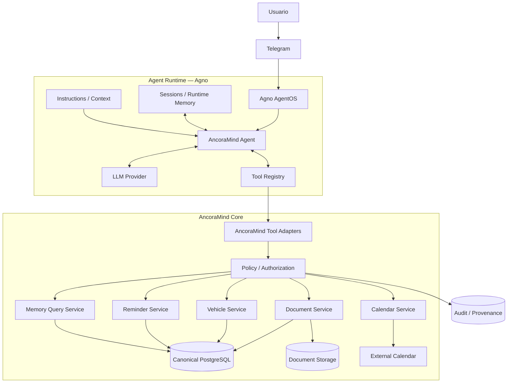
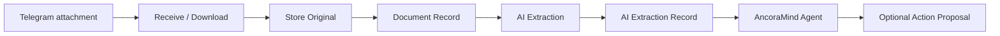

# AncoraMind Architecture

> **Versión:** 1.0 | **Estado:** POC/MVP | **Última actualización:** 2026-08-23

---

## 1. Visión general

AncoraMind es un **asistente personal agentic** con inteligencia artificial generativa.

Se comporta como un **inbox personal inteligente con memoria operativa**:
recibe información cotidiana desordenada y la convierte progresivamente en
conversaciones útiles, información estructurada, documentos archivados,
datos operativos, recordatorios, eventos y acciones propuestas.

---

## 2. Principios arquitectónicos

### 2.1 Un agente principal

AncoraMind utiliza un **único agente conversacional principal** (`AncoraMind Agent`)
con múltiples Tools.

```
AncoraMind Agent
│
├── document tools
├── vehicle tools
├── reminder tools
├── calendar tools
├── memory tools
└── utility tools
```

**Principio:** añadir capacidad ≈ añadir Tool.

Los subagentes solo se introducirán cuando exista razonamiento especializado
verdaderamente independiente.

### 2.2 Separación Runtime / Core

La arquitectura contiene **dos áreas deliberadamente separadas**:

| Área | Responsabilidad | Naturaleza |
|---|---|---|
| **Agent Runtime** (Agno + AgentOS) | Ejecución del agente, tool calling, sesiones, streaming, Telegram, HITL, tracing | Infraestructura reemplazable |
| **AncoraMind Core** | Lógica de negocio, autorización, persistencia canónica, gobernanza, auditoría | Producto |

### 2.3 Frontera probabilístico / determinista

```
       LLM / Agent
            │      probabilistic
            ▼
          Tools
            │      controlled
            ▼
   AncoraMind Core
            │      deterministic
            ▼
     Canonical Data
```

| Capa | Decide |
|---|---|
| **Agent Runtime** (probabilístico) | Qué quiere el usuario, qué Tool usar, cómo redactar la respuesta |
| **AncoraMind Core** (determinista) | Quién es el usuario, qué puede consultar/modificar, confirmación, persistencia |

> El LLM puede decidir **qué capability solicitar**. No puede decidir **qué permisos tiene**.
---

## 3. Diagrama de arquitectura



---

## 4. Stack tecnológico

| Componente | Tecnología | Notas |
|---|---|---|
| **Runtime agentic** | Agno + AgentOS | Infraestructura reemplazable |
| **Lenguaje** | Python 3.12+ | |
| **Base de datos canónica** | PostgreSQL | Schemas separados: `agno_runtime` / `ancora` |
| **Almacenamiento documental** | Filesystem local (POC), S3/MinIO/R2 (prod) | Abstracción `DocumentStorage` |
| **Canal** | Telegram (private chats only) | Gestionado por AgentOS |
| **LLM** | Configurable (provider, model, base URL) | Sin lock-in |
| **Validación** | Pydantic | Schemas para extracciones estructuradas |
| **Despliegue** | Docker + Docker Compose | Preparado para Railway/VPS |
| **Migraciones** | Alembic | Propiedad exclusiva de AncoraMind |

---

## 5. Separación de bases de datos

Misma instancia PostgreSQL, schemas separados:

```
PostgreSQL
│
├── agno_runtime
│     ├── sessions
│     ├── runtime state
│     └── ...
│
└── ancora
      ├── users
      ├── channel_accounts
      ├── documents
      ├── ai_extractions
      ├── action_proposals
      ├── action_executions
      ├── vehicles
      ├── vehicle_maintenance
      └── reminders
```

> AncoraMind Core nunca depende del esquema interno de persistencia de Agno.

---

## 6. Modelo de datos inicial (POC/MVP)

```
users
channel_accounts

documents
ai_extractions

action_proposals
action_executions

vehicles
vehicle_maintenance

reminders
```

Opcionalmente: `messages`, `conversation_links`, `audit_events`.
---

## 7. Tres tipos de memoria

| Tipo | Propiedad | Persistencia | Naturaleza |
|---|---|---|---|
| **Conversation / Runtime** | Agno | Agno DB | Contexto conversacional inmediato |
| **Soft Personal** | Agno (futuro) | Memory de Agno | Preferencias, personalización |
| **Canonical** | AncoraMind Core | PostgreSQL (`ancora`) | Fuente de verdad |

> La memoria canónica tiene prioridad sobre inferencias conversacionales.

---

## 8. Pipeline documental



| Paso | Automático / Confirmación |
|---|---|
| Recibir original | Automático |
| Almacenar original | Automático |
| Registrar metadata | Automático |
| Analizar documento (IA) | Automático |
| Guardar extracción IA | Automático |
| Crear entidad canónica | Requiere confirmación |
| Registrar mantenimiento | Requiere confirmación |
| Crear recordatorio | Requiere confirmación |
| Crear evento | Requiere confirmación |

---

## 9. Tool Architecture

Una Tool no contiene toda la lógica de negocio:

```
Agent
 ↓
Agno Tool (thin adapter)
 ↓
Application Service
 ↓
Repository
 ↓
Database
```

```python
@tool
def get_vehicle_summary(vehicle_reference: str | None = None):
    user_context = get_current_user_context()
    return vehicle_service.get_summary(
        user_context=user_context,
        reference=vehicle_reference,
    )
```

---
## 10. Capabilities iniciales

| Dominio | Tools | Riesgo |
|---|---|---|
| **Utility** | `get_current_datetime` | READ |
| **Memory** | `remember_note`, `search_notes` | READ/WRITE |
| **Documents** | `get_document`, `search_documents`, `analyze_document`, `delete_document` | READ/DESTRUCTIVE |
| **Vehicles** | `find_vehicle`, `get_vehicle_summary`, `get_vehicle_maintenance_history`, `register_vehicle_maintenance` | READ/WRITE |
| **Reminders** | `create_reminder` | WRITE |
| **Calendar** | `check_calendar`, `create_calendar_event` | READ/EXTERNAL_ACTION |

---

## 11. Canales

### Telegram (inicial)

- Solo **private chats**
- Grupos, supergrupos y canales deben rechazarse antes de cualquier acceso
- Gestionado por AgentOS (webhook, entrada, streaming, sesiones)

---

## 12. Trusted User Context

La identidad nunca procede del LLM:

```
Telegram chat → channel account → AncoraMind user → UserContext
```

```python
@dataclass
class UserContext:
    user_id: UUID
    channel: str
    external_chat_id: str
```

El LLM nunca proporciona `user_id`, `owner_id`, `internal_account_id`.

---

## 13. Human in the Loop

```
Agent → Tool request → Policy Engine → ActionProposal →
Agno HITL → usuario confirma → Core valida → acción → audit
```

Estados: `pending_confirmation`, `confirmed`, `discarded`, `executed`, `failed`.

---

## 14. Seguridad

- Telegram private chats only + allowlisted users
- Runtime-derived identity (no owner IDs from LLM)
- No arbitrary SQL Tools — parameterized DB access
- Private document storage with path traversal protection
- Secrets via environment variables
- File size limits + MIME validation + filename sanitization

---

## 15. Evolución futura

```
POC → usable MVP → document memory → multiple domains →
semantic retrieval (pgvector si justificado) → MCP ecosystem →
background capabilities → multi-channel → production hardening
```

LangGraph se permitirá cuando una capability requiera durable workflow,
explicit states, o long pause/resume. No justifica convertir todo AncoraMind en LangGraph.

---

## 16. Regla fundamental

> **Agno es infraestructura reemplazable. AncoraMind Core es el producto.**

La lógica de negocio no depende del modelo interno de Agno.
La misma lógica debe poder invocarse desde Agno Tool, REST API, MCP Server,
CLI, background worker, LangGraph workflow, u otro Agent Runtime — sin duplicación.