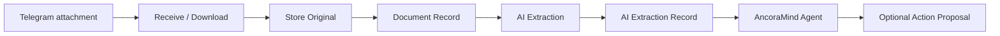

# AncoraMind Architecture

> **Versión:** 1.1 | **Estado:** POC/MVP | **Última actualización:** 2026-09-13

---

## 1. Visión general

AncoraMind es un **asistente personal agentic** con inteligencia artificial generativa.

Se comporta como un **inbox personal inteligente con memoria operativa**:
recibe información cotidiana desordenada y la convierte progresivamente en
conversaciones útiles, información estructurada, documentos archivados,
datos operativos, recordatorios, eventos y acciones propuestas.

---

## 2. Principios arquitectónicos

### 2.1 Un agente principal

AncoraMind utiliza un **único agente conversacional principal** (`AncoraMind Agent`)
con múltiples Tools.

```
AncoraMind Agent
│
├── document tools
├── vehicle tools
├── reminder tools
├── calendar tools
├── memory tools
└── utility tools
```

**Principio:** añadir capacidad ≈ añadir Tool.

Los subagentes solo se introducirán cuando exista razonamiento especializado
verdaderamente independiente.

### 2.2 Separación Runtime / Core

La arquitectura contiene **dos áreas deliberadamente separadas**:

| Área | Responsabilidad | Naturaleza |
|---|---|---|
| **Agent Runtime** (Agno + AgentOS) | Ejecución del agente, tool calling, sesiones, streaming, Telegram, HITL, tracing | Infraestructura reemplazable |
| **AncoraMind Core** | Lógica de negocio, autorización, persistencia canónica, gobernanza, auditoría | Producto |

### 2.3 Frontera probabilístico / determinista

```
       LLM / Agent
            │      probabilistic
            ▼
          Tools
            │      controlled
            ▼
   AncoraMind Core
            │      deterministic
            ▼
     Canonical Data
```

| Capa | Decide |
|---|---|
| **Agent Runtime** (probabilístico) | Qué quiere el usuario, qué Tool usar, cómo redactar la respuesta |
| **AncoraMind Core** (determinista) | Quién es el usuario, qué puede consultar/modificar, confirmación, persistencia |

> El LLM puede decidir **qué capability solicitar**. No puede decidir **qué permisos tiene**.

### 2.4 Acceso LLM gobernado (target aprobado)

El acceso a modelos es una capability de infraestructura gobernada, no una
llamada directa dispersa desde el Agent. El target de BL-23/specs/013 es:

```text
Agent → logical route → Governed LLM Access → LiteLLM Proxy
      → OpenRouter → provider/model físico
```

- Cada ejecución captura una revisión inmutable de configuración runtime.
- Toda inferencia comparte `ExecutionContext`, budget, coste y correlación.
- Los secrets permanecen en Railway environment y nunca en configuración
  dinámica.
- El Gateway falla cerrado; una caída no habilita bypass directo.
- `tool_call_limit=12` será un hard safety ceiling, no la protección principal.

Esta sección describe arquitectura aprobada **pendiente de implementación**. El
runtime actual continúa usando provider/model de environment y OpenRouter
directo hasta completar specs/013.

---

## 3. Diagrama de arquitectura

```mermaid
flowchart TB

    USER[Usuario]

    USER --> TG[Telegram]

    TG --> ADMISSION[Telegram Admission / Idempotency]
    ADMISSION --> AGNO[Agno AgentOS]

    subgraph Runtime["Agent Runtime — Agno"]
        AGNO --> AGENT[AncoraMind Agent]

        AGENT <--> LLMACCESS[Governed LLM Access]

        AGENT <--> TOOLS[Tool Registry]

        SESSION[Sessions / Runtime Memory]
        SESSION <--> AGENT

        CONTEXT[Instructions / Context]
        CONTEXT --> AGENT
    end

    LLMACCESS --> GATEWAY[LiteLLM Proxy]
    GATEWAY --> LLM[OpenRouter / LLM Provider]

    TOOLS --> ADAPTERS[AncoraMind Tool Adapters]

    subgraph Core["AncoraMind Core"]
        ADAPTERS --> POLICY[Policy / Authorization]

        POLICY --> DOCUMENTS[Document Service]
        POLICY --> VEHICLES[Vehicle Service]
        POLICY --> REMINDERS[Reminder Service]
        POLICY --> CALENDAR[Calendar Service]
        POLICY --> MEMORY[Memory Query Service]

        DOCUMENTS --> DOMAINDB[(Canonical PostgreSQL)]
        VEHICLES --> DOMAINDB
        REMINDERS --> DOMAINDB
        MEMORY --> DOMAINDB

        DOCUMENTS --> STORAGE[(Document Storage)]

        CALENDAR --> EXT[External Calendar]
    end

    COREAUDIT[(Audit / Provenance)]

    POLICY --> COREAUDIT

    ADMISSION --> INTERACTIONS[(Interaction Ledger)]
```



> El diagrama representa el target de specs/013. Admission, Interaction Ledger
> y LiteLLM todavía no forman parte del runtime implementado.

---

## 4. Stack tecnológico

| Componente | Tecnología | Notas |
|---|---|---|
| **Runtime agentic** | Agno + AgentOS | Infraestructura reemplazable |
| **Lenguaje** | Python 3.12+ | |
| **Base de datos canónica** | PostgreSQL + pgvector | Schemas separados: `agno_runtime` / `ancora`; retrieval documental en el schema canónico |
| **Almacenamiento documental** | Filesystem local (POC), S3/MinIO/R2 (prod) | Abstracción `DocumentStorage` |
| **Canal** | Telegram (private chats only) | Gestionado por AgentOS |
| **LLM** | Rutas lógicas + LiteLLM Proxy (target specs/013) | OpenRouter upstream; config runtime versionada |
| **Validación** | Pydantic | Schemas para extracciones estructuradas |
| **Observabilidad** | OpenTelemetry metadata-only + Collector/Grafana Cloud | Collector privado desplegado y métricas base ingeridas; dashboard/alertas y matriz T7 pendientes |
| **Despliegue** | Docker + Railway | Una réplica inicial; servicios privados para Gateway/Collector |
| **Migraciones** | Alembic | Propiedad exclusiva de AncoraMind |

---

## 5. Separación de bases de datos

Misma instancia PostgreSQL, schemas separados:

```
PostgreSQL
│
├── agno_runtime
│     ├── sessions
│     ├── runtime state
│     └── ...
│
└── ancora
      ├── users
      ├── channel_accounts
      ├── documents
      ├── ai_extractions
       ├── document_search_chunks
      ├── action_proposals
      ├── action_executions
      ├── vehicles
      ├── vehicle_maintenance
      └── reminders
```

> AncoraMind Core nunca depende del esquema interno de persistencia de Agno.

---

## 6. Modelo de datos inicial (POC/MVP)

```
users
channel_accounts

documents
ai_extractions

action_proposals
action_executions

vehicles
vehicle_maintenance

reminders
```

Opcionalmente: `messages`, `conversation_links`, `audit_events`.
---

## 7. Tres tipos de memoria

| Tipo | Propiedad | Persistencia | Naturaleza |
|---|---|---|---|
| **Conversation / Runtime** | Agno | Agno DB | Contexto conversacional inmediato |
| **Soft Personal** | AncoraMind Core (diseño en specs/029 — BL-13, "Dream") | PostgreSQL (`ancora`) | Preferencias/hábitos consolidados por un proceso incremental, con provenance y estados; nunca es memoria canónica |
| **Canonical** | AncoraMind Core | PostgreSQL (`ancora`) | Fuente de verdad |

> La memoria canónica tiene prioridad sobre inferencias conversacionales.

---

## 8. Pipeline documental



| Paso | Automático / Confirmación |
|---|---|
| Recibir original | Automático |
| Almacenar original | Automático |
| Registrar metadata | Automático |
| Analizar documento (IA) | Automático |
| Guardar extracción IA | Automático |
| Crear entidad canónica | Requiere confirmación |
| Registrar mantenimiento | Requiere confirmación |
| Crear recordatorio | Requiere confirmación |
| Crear evento | Requiere confirmación |

---

## 9. Tool Architecture

Una Tool no contiene toda la lógica de negocio:

```
Agent
 ↓
Agno Tool (thin adapter)
 ↓
Application Service
 ↓
Repository
 ↓
Database
```

```python
@tool
def get_vehicle_summary(vehicle_reference: str | None = None):
    user_context = get_current_user_context()
    return vehicle_service.get_summary(
        user_context=user_context,
        reference=vehicle_reference,
    )
```

---
## 10. Capabilities iniciales

> Tabla sincronizada con `README.md` §Capabilities. El Agent solo consulta y
> propone: confirmación/ejecución pertenecen al Core (hardening local 2026-10-11,
> pendiente rollout). Sin `ANCORA_DATABASE_URL` se omiten tools de BD; tiempo,
> exportación y búsqueda web siguen sujetos a su configuración propia.

| Dominio | Tools | Riesgo |
|---|---|---|
| System | `get_current_datetime` | READ |
| Notes | `propose_note`, `search_notes` | WRITE/READ |
| Documents | `search_documents`, `search_documents_semantically`, `get_document`, `analyze_document`, `propose_document_delete`, `export_document` | READ/EXTRACT/DESTRUCTIVE/EXPORT |
| Vehicles | `find_vehicle`, `get_vehicle_summary`, `get_vehicle_maintenance_history` | READ |
| Vehicles (creation) | `propose_vehicle` | WRITE |
| Vehicles (write) | `propose_vehicle_maintenance` | WRITE |
| Reminders | `list_reminders`, `propose_reminder`, `propose_reminder_snooze` | READ/WRITE |
| Calendar | `check_calendar`, `propose_calendar_event` | READ/EXTERNAL_ACTION |
| TODO lists | `list_todo_lists`, `propose_todo_list`, `propose_todo_list_rename`, `propose_todo_list_delete` | READ/WRITE/DESTRUCTIVE |
| TODO items | `list_todo_items`, `propose_todo_item`, `propose_todo_item_update`, `propose_todo_item_complete`, `propose_todo_item_reopen`, `propose_todo_item_move`, `propose_todo_item_delete` | READ/WRITE/DESTRUCTIVE |

Toda operación WRITE/EXTERNAL_ACTION/DESTRUCTIVE sigue el patrón ActionProposal:
`propose_*` → evento humano validado por el Core → `ProposalExecutor` → auditoría.
El catálogo excluye `execute_*` y la API legacy rechaza sin I/O; ni siquiera una
propuesta ya confirmada puede consumirse desde una tool fuera del claim atómico.
Con `GOVERNED_CONSENT_ENABLED=false` no se ejecutan propuestas.

---

## 11. Canales

### Telegram (inicial)

- Solo **private chats**
- Grupos, supergrupos y canales deben rechazarse antes de cualquier acceso
- El target de specs/013 introduce admission propio antes de AgentOS: secret,
  allowlist, idempotencia durable, rate limit y correlación
- Mismo `bot_id + update_id` → como máximo una ejecución Agent y una respuesta
  o acción lógica persistida
- Semántica de crash: `accepted` es recuperable; después de `agent_started` no
  hay replay automático y un resultado incierto queda `failed_ambiguous`
- Hasta implementar specs/013, webhook, entrada, streaming y sesiones siguen
  gestionados directamente por AgentOS

---

## 12. Trusted User Context

La identidad nunca procede del LLM:

```
Telegram chat → channel account → AncoraMind user → UserContext
```

```python
@dataclass
class UserContext:
    user_id: UUID
    channel: str
    external_chat_id: str
```

El LLM nunca proporciona `user_id`, `owner_id`, `internal_account_id`.

---

## 13. Human in the Loop

```
Agent → Tool request → Policy Engine → ActionProposal →
Agno HITL → usuario confirma → Core valida → acción → audit
```

Estados: `pending_confirmation`, `confirmed`, `discarded`, `executed`, `failed`.

---

## 14. Seguridad

- Telegram private chats only + allowlisted users
- Runtime-derived identity (no owner IDs from LLM)
- No arbitrary SQL Tools — parameterized DB access
- Private document storage with path traversal protection
- Secrets via environment variables
- File size limits + MIME validation + filename sanitization
- Idempotencia, rate limiting, concurrency y execution budget son controles
  distintos y no se sustituyen entre sí (target specs/013)
- API administrativa de runtime config separada del Agent y nunca expuesta como
  tool del LLM
- LiteLLM y OpenTelemetry Collector solo por red privada Railway

### 14.1 Observabilidad y privacidad (T10 implementado localmente)

- OpenTelemetry es el estándar; Grafana Cloud es el backend inicial mediante un
  Collector upstream privado cuyo manifiesto vive en `observability/`
- Collector/Grafana fallan abiertos respecto a la funcionalidad; LiteLLM falla
  cerrado respecto a inferencia
- La telemetría de producto de Agno está desactivada en Agent, AgentOS, entorno
  local y Docker; AncoraMind usa su propia fachada metadata-only
- Logs/traces usan allowlist de metadata: no prompts, mensajes, respuestas,
  documentos, extracciones ni argumentos/resultados completos de tools
- PostgreSQL conserva auditoría durable; Grafana se usa para diagnóstico,
  métricas y alertas

---

## 15. Evolución futura

```
POC → usable MVP → document memory → multiple domains →
semantic retrieval (pgvector si justificado) → MCP ecosystem →
background capabilities → multi-channel → production hardening
```

LangGraph se permitirá cuando una capability requiera durable workflow,
explicit states, o long pause/resume. No justifica convertir todo AncoraMind en LangGraph.

---

## 16. Regla fundamental

> **Agno es infraestructura reemplazable. AncoraMind Core es el producto.**

La lógica de negocio no depende del modelo interno de Agno.
La misma lógica debe poder invocarse desde Agno Tool, REST API, MCP Server,
CLI, background worker, LangGraph workflow, u otro Agent Runtime — sin duplicación.
