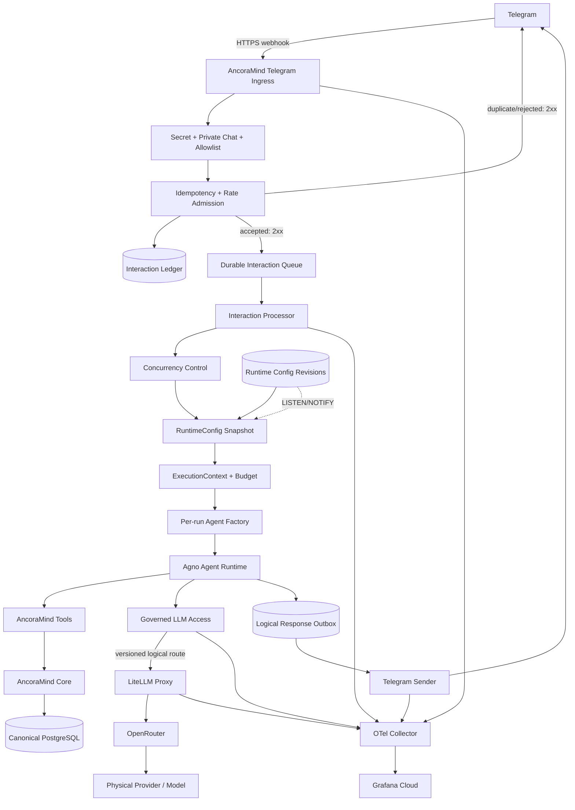
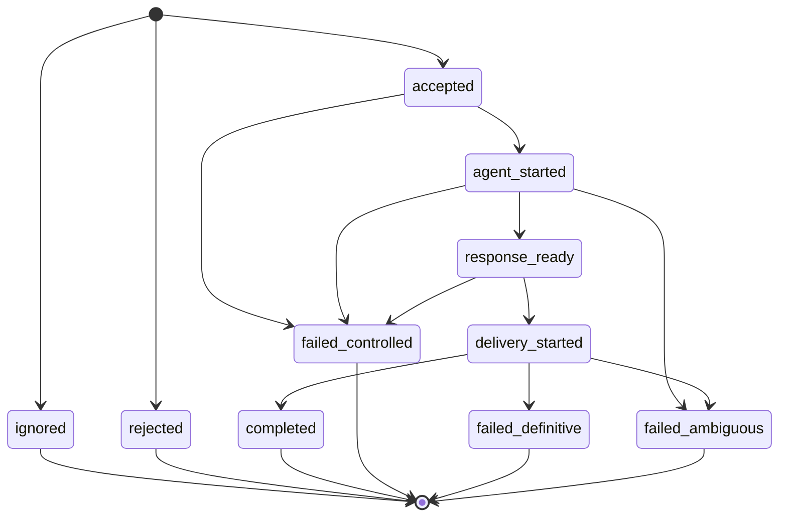

# Design: 013 — Governed LLM Access and Telegram Admission

> **Estado:** diseño aprobado; implementación pendiente.
> **Decisiones:** ADR-004, ADR-005 y ADR-006.

---

## 1. Current state

El assessment se realizó sobre el commit `9fe67ec` con Agno 2.9.0. El flujo
actual es:

```text
Telegram
  -> /telegram/webhook generado por AgentOS
  -> FastAPI BackgroundTask
  -> Agent singleton
  -> SafeOpenRouter
  -> OpenRouter
  -> provider/model físico
```

Hallazgos relevantes:

- Agno recibe `update_id` en el webhook y `message.message_id` en el task de
  procesamiento.
- La deduplicación de Agno es un diccionario en memoria con TTL de 60 segundos;
  no es durable ni compartido entre procesos/restarts.
- Un update nuevo recibe `200 {"status":"processing"}` después de encolar un
  BackgroundTask; la inferencia lenta no retrasa el `2xx`, pero un crash puede
  perder el trabajo ya aceptado.
- `message_id`, `update_id` y `X-Railway-Request-Id` no se persisten ni se
  propagan al run.
- `ALLOWED_TELEGRAM_USER_IDS` solo controla actualmente un booleano de menciones
  en grupos; no aplica una allowlist real. El router también permite grupos si
  se menciona al bot.
- Provider/model se instancian al arrancar desde environment y el Agent conserva
  el objeto físico durante toda la vida del proceso.
- `DocumentService` crea un segundo Agent directamente para extracción y silencia
  excepciones, sin compartir un budget transversal.
- El único límite explícito es `tool_call_limit=8`; el target aprobado es 12.
- Agent y Model usan retries 0 y no hay fallback configurado en AncoraMind.
- Agent y AgentOS tienen telemetría de producto Agno habilitada por default;
  tracing propio no está configurado.

## 2. Target architecture



## 3. Interaction identity and correlation

| Identifier | Source | Scope |
|---|---|---|
| `railway_request_id` | Railway | Una delivery HTTP |
| `telegram_update_id` | Telegram | Un update lógico por bot |
| `telegram_message_id` | Telegram | Un mensaje dentro del chat |
| `correlation_id` | AncoraMind | Una interacción, estable entre duplicados |
| `agno_run_id` | AncoraMind/Agno | Una ejecución Agent |
| `agno_session_id` | Agno | Una conversación |
| `llm_call_id` | AncoraMind | Un model turn lógico |
| `gateway_request_id` | LiteLLM | Una llamada al Gateway |
| `provider_request_id` | OpenRouter/provider | Un request upstream visible |

La clave de idempotencia primaria será:

```text
UNIQUE(bot_id, telegram_update_id)
```

`bot_id` es el ID numérico obtenido de Telegram `getMe`, nunca el token.

## 4. Interaction state machine



Semántica de recuperación:

| Estado encontrado tras restart | Acción |
|---|---|
| `accepted` | Puede reclamarse e iniciar el Agent una vez |
| `agent_started` | Marcar `failed_ambiguous`; no replay |
| `response_ready` | Continuar al delivery |
| `delivery_started` | Marcar `failed_ambiguous`; no reenvío automático |
| Terminal | No ejecutar trabajo adicional |

## 5. Telegram admission algorithm

Orden normativo:

```text
1. Validar secret Telegram
2. Parsear update_id y metadatos mínimos
3. Capturar X-Railway-Request-Id
4. BEGIN
5. INSERT interaction ON CONFLICT DO NOTHING
6. Si duplicate: INSERT delivery duplicate=true; COMMIT; return 200
7. Validar private chat y allowlist
8. Aplicar rate/queue admission
9. Persistir payload normalizado y cifrado si fue aceptado
10. COMMIT
11. return 200
```

Si PostgreSQL falla antes del commit, devolver `500/503`, no `2xx`, para que
Telegram pueda reentregar un update que todavía no tiene garantía durable.

| Caso | HTTP | IA |
|---|---:|---:|
| Aceptado durablemente | 200 | Encolada una vez |
| Duplicado | 200 | No |
| No autorizado/no privado | 200 | No |
| Rate/budget/cola rechazado | 200 | No |
| Update no soportado | 200 | No |
| Secret inválido | 403 | No |
| Payload malformado | 400 | No |
| DB no disponible antes del commit | 503 | No |

## 6. Conceptual persistence model

La implementación final se realizará con migraciones reproducibles; este diseño
no es SQL ejecutable.

### `telegram_interactions`

```text
id UUID PRIMARY KEY                 # correlation_id
bot_id BIGINT NOT NULL
telegram_update_id BIGINT NOT NULL
telegram_message_id BIGINT
chat_id BIGINT
telegram_user_id BIGINT
update_type VARCHAR
status VARCHAR NOT NULL

payload_ciphertext BYTEA
payload_key_version INT
payload_fingerprint VARCHAR

config_revision BIGINT
agno_session_id VARCHAR
agno_run_id VARCHAR

model_call_count INT
gateway_request_count INT
tool_call_count INT
estimated_cost NUMERIC
actual_cost NUMERIC
error_class VARCHAR
error_detail_code VARCHAR

received_at TIMESTAMPTZ
accepted_at TIMESTAMPTZ
agent_started_at TIMESTAMPTZ
response_ready_at TIMESTAMPTZ
delivery_started_at TIMESTAMPTZ
completed_at TIMESTAMPTZ
updated_at TIMESTAMPTZ

UNIQUE(bot_id, telegram_update_id)
UNIQUE(agno_run_id)
```

### `telegram_deliveries`

```text
id UUID PRIMARY KEY
interaction_id UUID NOT NULL
railway_request_id VARCHAR
duplicate BOOLEAN NOT NULL
http_status INT
delivery_status VARCHAR
received_at TIMESTAMPTZ
```

### `logical_responses`

```text
id UUID PRIMARY KEY
interaction_id UUID NOT NULL
response_kind VARCHAR NOT NULL
content_ciphertext BYTEA
content_key_version INT
content_length INT
chunk_count INT
status VARCHAR
created_at TIMESTAMPTZ

UNIQUE(interaction_id, response_kind)
```

### `telegram_response_deliveries`

```text
id UUID PRIMARY KEY
logical_response_id UUID NOT NULL
chunk_index INT NOT NULL
status VARCHAR NOT NULL
telegram_message_id BIGINT
started_at TIMESTAMPTZ
completed_at TIMESTAMPTZ
error_class VARCHAR

UNIQUE(logical_response_id, chunk_index)
```

### `llm_usage_events`

```text
id UUID PRIMARY KEY
interaction_id UUID NOT NULL
llm_call_id UUID UNIQUE NOT NULL
config_revision BIGINT NOT NULL
logical_route VARCHAR NOT NULL
effective_gateway_route VARCHAR NOT NULL
gateway_request_id VARCHAR
provider_request_id VARCHAR
provider VARCHAR
model VARCHAR
input_tokens INT
output_tokens INT
total_tokens INT
estimated_cost NUMERIC
actual_cost NUMERIC
cost_source VARCHAR
latency_ms INT
time_to_first_token_ms INT
retry_count INT
fallback_used BOOLEAN
status VARCHAR
error_class VARCHAR
created_at TIMESTAMPTZ
```

### Runtime config tables

```text
runtime_config_revisions
  revision BIGSERIAL PRIMARY KEY
  schema_version INT
  config JSONB
  checksum VARCHAR
  validation_status VARCHAR
  validation_errors JSONB
  created_by VARCHAR
  reason VARCHAR
  created_at TIMESTAMPTZ

runtime_config_active
  singleton_id BOOLEAN PRIMARY KEY
  active_revision BIGINT
  updated_at TIMESTAMPTZ

runtime_config_activations
  id UUID PRIMARY KEY
  revision BIGINT
  previous_revision BIGINT
  actor VARCHAR
  reason VARCHAR
  activated_at TIMESTAMPTZ
```

`action_proposals` añadirá conceptualmente `source_interaction_id`,
`idempotency_key` y `arguments_fingerprint`, con unique constraint sobre la
idempotency key.

## 7. Payload and response privacy

El payload durable solo contendrá el input normalizado necesario para recuperar
un estado `accepted`. Se cifra a nivel de aplicación; la clave y su rotación
viven en Railway secrets. No se exporta a Grafana.

Retención inicial objetivo:

| Dato | Retención |
|---|---:|
| Payload de interacción completada/rechazada | <= 24 horas |
| Payload `failed_ambiguous` | 7 días |
| Metadata de interacción | 90 días |
| Auditoría de configuración | Mientras exista el sistema |
| Prompts/respuestas en telemetry | Nunca |

## 8. Processor, ordering and response outbox

Con una réplica se usarán:

```text
asyncio.Semaphore(2) global
+ lock por user
+ lock por chat
```

La cola ordena por `chat_id`, `received_at` y `telegram_update_id`. Los mensajes
de un mismo chat no se ejecutan en paralelo para evitar carreras sobre la sesión
Agno.

El streaming interno del modelo puede mantenerse, pero el streaming visible en
Telegram se desactiva inicialmente. Se refresca `typing` y se persiste una
respuesta lógica final antes del envío. Las respuestas largas se trocean de
forma determinista y cada chunk tiene estado propio.

## 9. RuntimeConfigManager

Contrato conceptual:

```python
class RuntimeConfigManager:
    async def initialize(self) -> None: ...
    def snapshot(self) -> RuntimeConfigSnapshot: ...
    async def validate(self, payload: dict) -> ValidationResult: ...
    async def publish(self, payload: dict, actor: str, reason: str) -> Revision: ...
    async def activate(
        self,
        revision: int,
        expected_current_revision: int,
        actor: str,
        reason: str,
    ) -> RuntimeConfigSnapshot: ...
    async def rollback(self, revision: int, actor: str, reason: str) -> None: ...
```

Garantías:

- `snapshot()` no hace I/O.
- El snapshot es inmutable y se asigna una vez al run.
- Una revisión inválida nunca sustituye last-known-good.
- Sin PostgreSQL durante startup se usa el bootstrap de environment y se
  deshabilita el control plane hasta recuperar la conexión.
- Con una réplica, la API puede hacer swap directo; `LISTEN/NOTIFY` se añade como
  invalidación multi-proceso, con reconexión y reconciliación lenta.

## 10. Typed runtime configuration

Revisión inicial aprobada:

```yaml
schema_version: 1

routing:
  default_route: ancoramind-default
  routes:
    ancoramind-default:
      effective_gateway_route: ancoramind-default-r1
      capabilities: [text, tool_calling, structured_output]
    ancoramind-fast:
      effective_gateway_route: ancoramind-fast-r1
      capabilities: [text, tool_calling]
    ancoramind-vision:
      effective_gateway_route: ancoramind-vision-r1
      capabilities: [text, vision, structured_output]

execution_budget:
  max_runtime_seconds: 120
  max_model_calls: 6
  max_tool_calls: 12
  max_same_tool_args_after_success: 1
  max_gateway_requests: 8
  max_gateway_attempts_per_model_call: 2
  max_output_tokens: 1024
  max_queue_wait_seconds: 30
  max_estimated_cost_usd: null

concurrency:
  per_chat: 1
  per_user: 1
  global: 2
  queued_per_chat: 5
  pending_global: 20

admission:
  user_burst: 5
  user_requests_per_minute: 10
  user_requests_per_hour: 120

gateway:
  request_timeout_seconds: 45
  retries: 0
  cross_model_fallbacks: 0
  cooldown_seconds: 60
  openrouter_provider_fallback: true

observability:
  traces_enabled: true
  metrics_enabled: true
  content_capture: false
  trace_sample_rate: 1.0
```

No se podrá activar una ruta de pago sin pricing conocido, budget por periodo,
coste máximo por interacción y hard limit externo.

## 11. Configuration publication and control plane

No hay transacción distribuida entre PostgreSQL de AncoraMind y la DB de
LiteLLM. La publicación usa dos fases:

```text
crear draft AncoraMind
-> validar schema e invariantes
-> crear alias versionado LiteLLM
-> healthcheck del alias
-> registrar checksum/artefacto Gateway
-> activar revisión AncoraMind
```

Un fallo anterior a la activación conserva la revisión vigente. Los aliases
versionados no se mutan mientras puedan estar en uso.

API administrativa inicial:

```text
GET  /admin/runtime-config/status
POST /admin/runtime-config/validate
POST /admin/runtime-config/revisions
POST /admin/runtime-config/revisions/{revision}/activate
POST /admin/runtime-config/rollback
```

La API usa bearer token en Railway secrets, no se expone como tool, no acepta
secrets en payload, no habilita CORS y audita actor/motivo. Inicialmente se opera
con `curl`/`Invoke-RestMethod`; la CLI futura reutiliza el mismo contrato.

## 12. Per-run Agent factory and LLMAccess

No se mutará el modelo de un Agent singleton. Cada ejecución realiza:

```text
RuntimeConfigSnapshot
-> GovernedModel para ruta versionada
-> Agent con ID lógico estable
-> arun(run_id explícito)
```

Contrato conceptual:

```python
class LLMAccess:
    def model_for(
        self,
        route: LogicalRoute,
        execution_context: ExecutionContext,
    ) -> Model:
        ...
```

La implementación exige contexto, consume budget, genera `llm_call_id`, propaga
`traceparent` y correlación, recoge usage/IDs y falla cerrada. No conoce secrets
físicos del provider.

## 13. ExecutionContext and ExecutionBudget

```python
class ExecutionContext:
    correlation_id: UUID
    telegram_update_id: int
    telegram_message_id: int | None
    railway_request_id: str | None
    agno_run_id: str
    agno_session_id: str
    config: RuntimeConfigSnapshot
    budget: ExecutionBudget
```

`ExecutionBudget` mantiene deadline, model calls, Gateway requests, tools,
coste, retries/fallbacks y fingerprints. Se propaga mediante `ContextVar` y sus
contadores son seguros frente a tools async concurrentes.

Antes de cada model call se comprueban deadline, llamadas, attempts, coste y
circuit. Antes de cada tool se comprueban deadline, hard ceiling, riesgo y:

```text
HMAC(tool_name + canonical_json(arguments))
```

Los argumentos no se exportan; el HMAC usa una clave interna en Railway.

Se aprovecharán `tool_hooks`, eventos de model request, `RunContext.metadata`,
`run_id`, métricas de `RunOutput` y `StopAgentRun` de Agno 2.9.0. En esta
versión `StopAgentRun` se importa desde `agno.exceptions`, no desde
`agno.agent`. El hook async transforma una violación de presupuesto en ese
control de flujo para terminar el loop después de la tool rechazada, sin una
nueva inferencia. No se reimplementará el loop agentic.

## 14. Document extraction

La dependencia directa de Agno dentro de `domain/documents` se sustituirá por un
port `DocumentExtractionPort`. Su adaptador usará `LLMAccess`, la ruta adecuada
(`ancoramind-vision` o extracción), el mismo budget y trace, y registrará
provider/model reales. Los errores dejarán metadata observable y no se
silenciarán indiscriminadamente.

## 15. Retry, fallback and circuit policy

Política inicial:

```text
Agno Agent retries = 0
Agno Model retries = 0
LiteLLM retries = 0
LiteLLM cross-model fallback = 0
OpenRouter provider fallback = enabled
LiteLLM cooldown = 60 seconds
```

Evolución posterior, solo con métricas: máximo un retry o un fallback, siempre
dentro de `max_gateway_attempts_per_model_call=2`.

| Error | Retry/fallback inicial |
|---|---|
| Authentication/forbidden/invalid request/model missing | No |
| Schema/payload inválido | No |
| Context overflow | Solo ruta explícita mayor en evolución futura |
| Timeout antes de tokens/network/5xx | Futuro, limitado |
| 429 | Sin retry inmediato; posible fallback futuro |
| Fallo tras emitir tokens | No automático |

El Gateway gestiona `CLOSED/OPEN/HALF_OPEN`. Circuit open implica fast failure y
cero llamadas al upstream afectado. AncoraMind no hace bypass.

## 16. Cost governance

```text
ExecutionBudget por interacción
-> budget por virtual key/ruta LiteLLM
-> budget diario/mensual
-> hard limit OpenRouter
```

Umbrales iniciales relativos: alerta al 60%, alerta fuerte al 80%, hard stop de
aplicación/Gateway al 90% y límite externo OpenRouter al 100%. La config contiene
un snapshot de pricing para estimar sin consultar DB por model call. El coste
real reconcilia la estimación cuando esté disponible.

## 17. OpenTelemetry design

Servicios:

```text
service.name=ancoramind-core
service.name=ancoramind-llm-gateway
service.name=ancoramind-otel-collector
```

Spans principales:

```text
telegram.webhook.delivery
telegram.idempotency.check
telegram.authorization.check
admission.rate_limit.check
interaction.queue.wait
interaction.process
runtime_config.snapshot
agno.agent.run
gen_ai.model.call
litellm.gateway.request
ancora.tool.call
execution_budget.check
telegram.response.send
```

Los IDs de correlación pueden ser atributos de spans/logs, pero no labels de
métricas de cardinalidad no acotada. Las métricas se agregan por environment,
ruta, provider, model, status, error class y circuit state.

Pipeline:

```text
OTLP receiver
-> resource enrichment
-> attribute allowlist/redaction
-> memory limiter
-> batch
-> bounded retry/export queue
-> Grafana Cloud
```

Collector/Grafana fallan abiertos respecto a funcionalidad. La telemetría Agno
se desactiva con `Agent(telemetry=False)`, `AgentOS(telemetry=False)` y
`AGNO_TELEMETRY=false`.

## 18. LiteLLM deployment and portability

LiteLLM se despliega privado en Railway, sin dominio público, con imagen fijada,
docs/OpenAPI desactivados, virtual key por environment y PostgreSQL dedicado.
Provider keys se referencian desde environment.

La configuración neutral y las revisiones pertenecen a AncoraMind. La DB de
LiteLLM contiene estado operacional sustituible: virtual keys, spend logs,
deployments y circuit/cooldown. Al cambiar Gateway se regeneran rutas y policies;
el histórico de spend puede exportarse o conservarse read-only.

## 19. Latency benchmark

Comparar:

```text
AncoraMind -> OpenRouter
AncoraMind -> LiteLLM SDK -> upstream mock
AncoraMind -> LiteLLM Proxy privado -> OpenRouter/upstream mock
```

Medir warmup y al menos 200 requests por variante: p50/p95/p99, TTFT, latencia
total, overhead puro, CPU y memoria. El criterio final se aprobará con datos, no
por suposición.

## 20. Migration strategy

La iniciativa crea tablas y modifica `action_proposals` sobre una base con
datos. Activa la necesidad real descrita en BL-12: `migrations/init.sql` no
puede añadir de forma fiable columnas/constraints a tablas existentes mediante
`CREATE TABLE IF NOT EXISTS`.

Antes del ledger productivo se debe introducir Alembic o aprobar una estrategia
equivalente reproducible. Se probarán fresh install, upgrade sobre datos y
downgrade de la última migración. `migrations/init.sql` puede mantenerse como
baseline fresh idempotente.

## 21. Rollout and rollback

- Feature flags para introducir ledger, processor, `LLMAccess`, Gateway y OTel
  por fases.
- Durante transición, OpenRouter directo solo puede existir detrás de
  `LLMAccess`; desaparece al declarar LiteLLM obligatorio.
- Rollback de config: activar revisión anterior sin redeploy.
- Rollback Gateway: reactivar alias versionado anterior, sin bypass.
- Rollback app: deployment anterior de Railway.
- Fallo de observabilidad: desactivar exporter; la app continúa.
- El webhook conserva `/telegram/webhook` para no requerir un registro nuevo.
